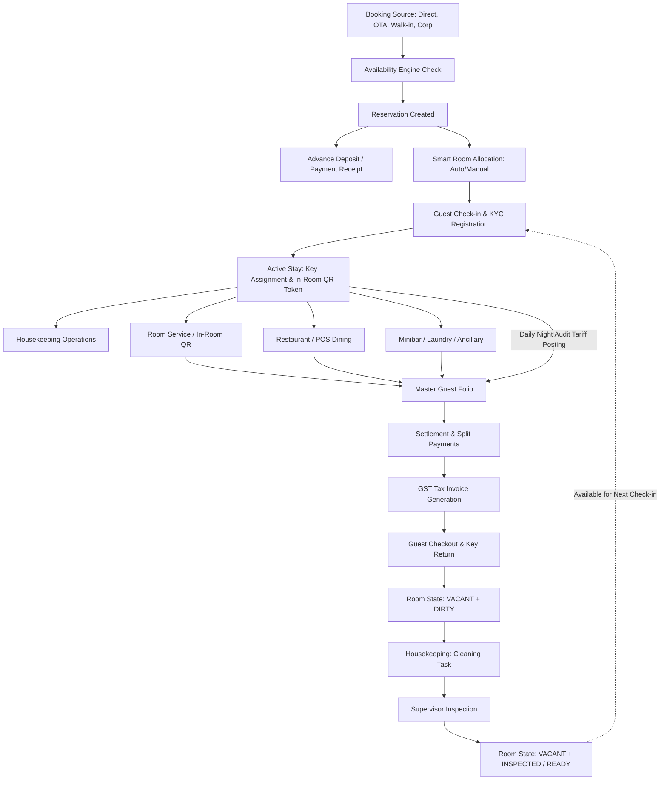

# 00-PROJECT-CONTEXT-AND-GLOSSARY.md
# TapMenu HMS — Project Context, Operating Philosophy, System Boundaries & Unified Glossary

---

## 1. Document Control & Metadata
- **Document Identifier:** `DOC-HMS-000`
- **System Name:** TapMenu HMS (Hotel Management & Unified Operations Platform)
- **Version:** 2.0.0
- **Document Status:** Implementation-Ready Engineering Specification
- **Authoring Role:** Senior Product Architect, Hospitality/PMS Domain Architect, System Architect
- **Primary Source:** `TapMenu_HMS_Final_Client_Specification(1).docx`
- **Classification:** Confidential / Core Engineering Specification

---

## 2. Product Vision & Business Objectives

### 2.1 Product Vision
`[SOURCE REQUIREMENT]`
TapMenu HMS is designed as a unified hospitality operating platform rather than a simple booking dashboard or fragmented point solutions. It combines Property Management System (PMS) capabilities, front desk operations, room inventory management, guest 360 CRM, housekeeping, maintenance, food & beverage (F&B) point of sale (POS) with Kitchen Display Systems (KDS), room service with in-room QR capabilities, centralized master guest folio billing with Indian GST compliance, day-end night audit, and management business intelligence (BI) into a single cohesive architecture.

### 2.2 Business Objectives
1. **Eliminate Operational Silos:** `[SOURCE REQUIREMENT]` Replace fragmented spreadsheets, paper-based slips, standalone restaurant POS machines, and disconnected channel extranets with a centralized operational engine.
2. **Unified Real-Time Inventory Control:** `[SOURCE REQUIREMENT]` Provide a single source of truth for hotel room availability to eradicate double-bookings, booking collisions, and inventory discrepancies between front desk, direct website, and online travel agents (OTAs).
3. **Consolidated Guest Ledger:** `[SOURCE REQUIREMENT]` Route all room tariffs, restaurant dining, in-room QR dining, laundry, minibar, airport transfers, and ancillary services into one immutable master guest folio for audit-compliant, transparent checkout and settlement.
4. **Frictionless Guest Experience:** `[SOURCE REQUIREMENT]` Offer contact-free in-room QR dining and service requests that feed directly into operational KDS and service queues without requiring guest app installation.
5. **Operational Accountability & Auditability:** `[SOURCE REQUIREMENT]` Record immutable audit trails for sensitive financial and operational events (discounts, rate overrides, cancellations, voids, refunds, room state transitions).
6. **Multi-Property Scalability:** `[SOURCE REQUIREMENT]` Provide a modular-monolith foundation capable of operating a single boutique property today and scaling to multi-property hotel chains with centralized reporting and tenant isolation.

---

## 3. Core HMS Operating Philosophy

The platform is engineered upon four inviolable architectural and domain pillars:

```
                    ┌───────────────────────────────────────────────┐
                    │               TAPMENU HMS CORE                │
                    └──────────────────────┬────────────────────────┘
                                           │
         ┌───────────────────┬─────────────┴───────┬───────────────────┐
         ▼                   ▼                     ▼                   ▼
┌─────────────────┐ ┌─────────────────┐ ┌───────────────────┐ ┌─────────────────┐
│  ONE INVENTORY  │ │ ONE RESERVATION │ │   ONE GUEST 360   │ │ ONE MASTER      │
│     ENGINE      │ │     ENGINE      │ │       VIEW        │ │     FOLIO       │
└─────────────────┘ └─────────────────┘ └───────────────────┘ └─────────────────┘
```

### 3.1 One Inventory Engine
- `[SOURCE REQUIREMENT]` There is only **one** authoritative inventory store in the system: the PostgreSQL database of TapMenu HMS.
- `[ENGINEERING DECISION]` Physical rooms map to sellable room types. Sellable inventory is tracked authoritatively in a materialized `daily_inventory` relational ledger within PostgreSQL.
- `[ENGINEERING DECISION]` Every reservation, block, out-of-order (OOO) condition, and maintenance lock decrements sellable availability within atomic PostgreSQL transactions using row-level locks (`SELECT ... FOR UPDATE`).
- `[ENGINEERING DECISION]` Redis is strictly an optional coordination, caching, and task-queue layer; reservation correctness and inventory validity **never** depend on Redis availability. If Redis is unavailable, the core booking engine remains 100% operational through direct PostgreSQL row locks.
- `[ENGINEERING DECISION]` External OTAs (Booking.com, Agoda, MakeMyTrip), booking engines, and internal front desk terminals are **consumers** and **feeders** of this inventory; they never maintain separate inventory authority.

### 3.2 One Reservation Engine
- `[SOURCE REQUIREMENT]` All reservations—regardless of whether they originate from front-desk walk-ins, phone inquiries, the hotel direct website, corporate allotments, travel agents, or external OTAs—follow an identical reservation lifecycle, state machine, and data schema.
- `[ENGINEERING DECISION]` No "shadow bookings" or temporary external records exist outside the authoritative reservation engine.

### 3.3 One Guest 360 View
- `[SOURCE REQUIREMENT]` A single persistent guest profile links historical stays, identity documents (KYC), billing history, preferences, dietary constraints, VIP classifications, and lifetime financial contribution across all properties within an organization.
- `[ENGINEERING DECISION]` Duplicate guest records are surfaced and merged systematically to preserve transaction history and maintain operational continuity.

### 3.4 One Master Folio
- `[SOURCE REQUIREMENT]` The master folio is the financial center of a guest's stay. All charges incurred during a stay—room tariff, restaurant meals, in-room dining via QR, laundry, minibar consumptions, spa, and transportation—are posted directly as debit line items into this ledger.
- `[SOURCE REQUIREMENT]` Split payments, corporate billing, advance deposits, and refunds are posted against this single ledger. Financial records are immutable; corrections require compensatory adjustment entries.

---

## 4. Hotel Operational Model & System Boundaries

### 4.1 Hotel Operational Model


### 4.2 System Boundaries & Trust Domains

```
┌─────────────────────────────────────────────────────────────────────────────┐
│ UNTRUSTED PUBLIC CLIENT DOMAIN                                              │
│ - Guest Smartphone (In-room QR / Room Service, Digital Folio Preview)       │
│ - Hotel Direct Website Booking Engine (Public Visitors)                     │
└──────────────────────────────────────┬──────────────────────────────────────┘
                                       │ HTTPS / TLS 1.3
                                       ▼
┌─────────────────────────────────────────────────────────────────────────────┐
│ REVERSE PROXY & PERIMETER SECURITY (Nginx)                                  │
│ - TLS Termination, Rate Limiting, DDoS Shield, CORS, Security Headers       │
└──────────────────────────────────────┬──────────────────────────────────────┘
                                       │ Reverse Proxy
                                       ▼
┌─────────────────────────────────────────────────────────────────────────────┐
│ APPLICATION TRUST DOMAIN (FastAPI Modular Monolith)                         │
│ - API Gateway & RBAC Guards                                                 │
│ - Core PMS & Front Desk Engine      - Housekeeping & Maintenance Engine     │
│ - Master Folio & GST Engine         - F&B POS & KDS Order Router            │
│ - Channel Manager Adapter Core      - Availability & Inventory Locker       │
└──────────────────────┬───────────────────────────────┬──────────────────────┘
                       │                               │
       SQLAlchemy 2.x  ▼                               ▼ Async Task Queue
┌──────────────────────────────┐              ┌───────────────────────────────┐
│ PERSISTENT DATA SOURCE       │              │ CACHE & ASYNC BROKER (Redis)  │
│ PostgreSQL 16+               │              │ - Fast Availability Cache     │
│ - Transactional Authority    │              │ - Celery Task Queue & Broker  │
│ - Row-Level Property Scope   │              │ - Rate Limiting & Ephemeral   │
│ - Immutable Audit & Folio    │              └───────────────┬───────────────┘
└──────────────┬───────────────┘                              │
               │                               Worker Pool    ▼
               ▼ S3 API                       ┌───────────────────────────────┐
┌──────────────────────────────┐              │ CELERY BACKGROUND WORKERS     │
│ S3-COMPATIBLE STORAGE        │              │ - Webhook Processing & Retry  │
│ - KYC Guest Documents        │              │ - Email / WhatsApp / SMS      │
│ - Invoices & Audit PDFs      │              │ - Night Audit Roll Over       │
│ - Maintenance Photos         │              │ - Channel ARI Push Sync       │
└──────────────────────────────┘              └───────────────────────────────┘
```

#### Boundaries & Rules:
1. **Public vs. Authenticated Web Surfaces:** The public hotel website booking flow and guest-facing in-room QR application interact exclusively with restricted, rate-limited public API endpoints. In-room ordering uses temporary, time-bound, cryptographically signed room tokens validated against active guest stays.
2. **Internal Operations Domain:** Front desk, housekeeping, restaurant POS, kitchen display, and management terminals require full JWT-based authentication and role-based access control (RBAC).
3. **External Distribution Boundary:** External OTAs (Booking.com, Agoda, MakeMyTrip) and GDS networks connect exclusively via an isolated Channel Manager Adapter Layer. Core PMS tables are never exposed directly to external systems.
4. **Stateless App Servers:** FastAPI application instances are stateless. Session states, temporary rate checks, and distributed locks are managed via Redis; all persistent state resides in PostgreSQL.

---

## 5. Domain Terminology & Comprehensive Glossary

### 5.1 Hospitality & PMS Operational Terminology

| Term | Domain Category | Precise Engineering & Operational Definition |
| :--- | :--- | :--- |
| **PMS** | Core PMS | **Property Management System:** The central software application responsible for managing day-to-day front office operations, room inventory, guest registrations, check-in/out, and room status. |
| **HMS** | Operations | **Hotel Management System:** The broader unified platform encompassing PMS, restaurant POS, KDS, housekeeping, maintenance, master billing, and owner BI. |
| **Physical Room** | Inventory | An individual, numbered, physical room unit existing in the hotel (e.g., Room 101, Room 204). It possesses physical attributes (floor, wing, maintenance state, housekeeping state). |
| **Room Type** | Inventory | A commercial categorization of rooms sharing identical baseline capacity, bed configurations, and amenity tiers (e.g., "Deluxe King", "Executive Suite"). |
| **Sellable Inventory** | Inventory | The net count of physical rooms within a room type that are commercially bookable on a specific date, calculated as: `Total Physical Rooms - Out of Order (OOO) - Guaranteed Reservations - Maintenance Holds`. |
| **Out of Order (OOO)** | Inventory / Maintenance | A physical room taken offline due to severe mechanical, structural, or maintenance failure. **Deducted from both total sellable inventory and total room capacity** for occupancy calculation. |
| **Out of Service (OOS)** | Inventory / Housekeeping | A room taken out of circulation for temporary minor repair, aesthetic touch-up, or VIP holding. **Not deducted from total room capacity**; affects immediate availability but remains in sellable capacity metrics. |
| **Stay** | Front Desk | The realized, active residency period of a guest occupying an assigned physical room, beginning with formal check-in and ending with formal checkout. |
| **Reservation** | Front Desk | A legal and commercial commitment between a guest/booker and the hotel for room occupancy across defined future arrival and departure dates. |
| **Walk-in** | Front Desk | A guest who arrives at the front desk requesting immediate accommodation without a prior booking. Handled via real-time availability check, room assignment, advance payment, and immediate check-in. |
| **No-Show** | Front Desk | A guaranteed reservation where the guest fails to arrive by the designated property cancellation cutoff time on the scheduled check-in date without prior notification. Triggers policy-driven cancellation fees. |
| **Day Use** | Front Desk | A room occupancy that checks in and checks out on the same business date without an overnight stay. |
| **Early Check-In** | Front Desk | Permitted registration and physical room access granted prior to the standard property check-in time (e.g., arriving at 09:00 when standard is 14:00), subject to early-check-in tariff policies. |
| **Late Checkout** | Front Desk | Permitted room retention beyond standard checkout time (e.g., departing at 16:00 when standard is 11:00), subject to manager approval and half-day/hourly surcharge policies. |
| **Room Allocation** | Front Desk | The binding assignment of a specific physical room number (e.g., Room 204) to a confirmed reservation. Can occur automatically via business rules or manually by front desk staff. |
| **Key Assignment** | Front Desk | The issuance and recording of physical key cards, mobile keys, or PIN codes mapped to a guest stay. |

### 5.2 Financial, Folio & Billing Terminology

| Term | Domain Category | Precise Engineering & Operational Definition |
| :--- | :--- | :--- |
| **Folio** | Finance | A formal accounting ledger of debits (charges) and credits (payments, deposits, allowances) belonging to an active or historical guest stay, group, or corporate account. |
| **Master Folio** | Finance | The primary parent ledger associated with a stay that aggregates room charges, restaurant bills, room service, minibar, laundry, and ancillary expenses. |
| **Split Folio** | Finance | The programmatic division of folio charges into distinct sub-ledgers (e.g., Folio A for room tariff billed to a corporate entity, Folio B for personal meals and minibar settled directly by the guest). |
| **Deposit / Advance** | Finance | Funds collected from a booker prior to check-in to secure a future reservation. Recorded as a liability credit until consumed against posted charges during or after check-in. |
| **Charge Posting** | Finance | An atomic transaction that appends a debit line item (representing consumed goods or services) to a folio, incrementing the outstanding balance. |
| **Settlement** | Finance | The formal process of applying payments (cash, card, UPI, bill-to-company) to balance all debits on a folio, reducing the net balance to zero. |
| **Void** | Finance | The absolute nullification of an erroneous transaction entry made within the same open shift/business date, requiring supervisor approval and full audit recording. |
| **Adjustment / Allowance** | Finance | A compensatory credit transaction posted against a previously finalized charge to correct billing errors, settle service recovery disputes, or issue price rebates. |
| **Credit Limit / Floor Limit** | Finance | The maximum allowable net debit balance a guest stay or corporate account may accumulate before front-desk intervention and intermediate settlement is mandatory. |
| **Bill to Company (BTC)** | Finance | A billing arrangement where verified charges are transferred from a guest folio to a vetted corporate City Ledger / Accounts Receivable account for invoicing on agreed credit terms. |
| **Business Date** | Finance / Audit | The operational calendar date of the hotel, controlled and advanced exclusively by the Night Audit process. It may differ from the actual physical clock date. |
| **Night Audit** | Finance / Operations | The mandatory end-of-day operational sequence that reconciles daily revenue, verifies cashier drawers, processes room tariff postings, identifies financial discrepancies, and rolls over the business date. |
| **Minor Currency Units** | Finance / Tech | Storing all monetary values as 64-bit integers representing the smallest currency unit (e.g., Paisa in INR, Cents in USD: ₹350.00 is stored as integer `35000`) to prevent IEEE 754 floating-point rounding errors. |
| **GST / SAC / HSN** | Tax Engine | Goods and Services Tax (India). Service Accounting Code (SAC) designates service categories (e.g., SAC 9963 for accommodation, SAC 996331 for restaurant services). HSN designates physical goods. |

### 5.3 Distribution, OTA & Channel Terminology

| Term | Domain Category | Precise Engineering & Operational Definition |
| :--- | :--- | :--- |
| **OTA** | Distribution | **Online Travel Agency:** Third-party web distribution platforms (e.g., Booking.com, Agoda, MakeMyTrip, Expedia) that resell hotel room inventory to consumers for a commission. |
| **Channel Manager** | Distribution | Software layer that synchronizes inventory, rates, restrictions, and bookings bidirectionally between the hotel's PMS and multiple external sales channels. |
| **ARI** | Distribution | **Availability, Rates, and Inventory:** The standard industry data payload pushed from the PMS / Channel Manager to external booking channels. |
| **Allotment** | Distribution | A designated block of rooms reserved for a specific sales channel, tour operator, or corporate client, either on a guaranteed or release-back basis. |
| **Cut-off Date** | Distribution | The deadline date by which unsold rooms in an allotment or group block are automatically released back into general sellable inventory. |
| **Rate Plan** | Revenue | A defined commercial pricing structure governing room rates, which dictates inclusions (e.g., EP: European Plan - Room Only, CP: Continental Plan - Bed & Breakfast), cancellation terms, and payment requirements. |
| **CTA / CTD** | Revenue | **Closed to Arrival / Closed to Departure:** Inventory restrictions preventing reservations from starting (CTA) or ending (CTD) on a specific calendar date. |
| **Min/Max LOS** | Revenue | **Minimum / Maximum Length of Stay:** Booking restrictions enforcing a minimum or maximum number of nights required to reserve a stay over specific dates. |
| **GDS** | Distribution | **Global Distribution System:** Worldwide computerized reservation network (e.g., Amadeus, Sabre) connecting travel agencies to airline, hotel, and car rental inventory. `[FUTURE]` |

### 5.4 F&B, Operations & Technical Terminology

| Term | Domain Category | Precise Engineering & Operational Definition |
| :--- | :--- | :--- |
| **POS** | F&B | **Point of Sale:** Terminal hardware and software used in hotel restaurants, bars, and banquet halls to enter guest orders, print kitchen tickets, and process billing. |
| **KDS** | F&B | **Kitchen Display System:** Digital screens positioned in kitchen preparation zones that display real-time incoming orders, preparation times, item modifications, and fulfillment statuses. |
| **KOT** | F&B | **Kitchen Order Ticket:** An itemized order dispatch slip (digital or printed on 58mm/80mm thermal paper) sent to the kitchen to initiate dish preparation. |
| **In-Room QR** | Guest Experience | A dynamic or static Quick Response code placed in guest rooms that launches a lightweight web app enabling guests to view menus, order room service, and submit service requests. |
| **BOM / Recipe** | F&B / Inventory | **Bill of Materials:** The structured breakdown of raw ingredients deducted from kitchen stock when a specific menu dish is prepared and billed. |
| **ADR** | Performance BI | **Average Daily Rate:** Industry performance metric: `Total Room Revenue / Number of Rooms Sold`. |
| **RevPAR** | Performance BI | **Revenue Per Available Room:** Key performance metric: `Total Room Revenue / Total Available Sellable Rooms` (or `Occupancy Rate × ADR`). |
| **RBAC** | Security | **Role-Based Access Control:** An authorization mechanism restricting system access and actions based on predefined organizational roles and granular permission sets. |

---

## 6. Conceptual Distinctions & Entity Relationships

To avoid implementation confusion, the table below defines the clear operational and architectural distinctions between easily conflated concepts:

```
┌──────────────────┐       1:N       ┌──────────────────┐       1:N       ┌──────────────────┐
│  GUEST PROFILE   │────────────────►│   RESERVATION    │────────────────►│    STAY (ROOM)   │
│  (Persistent ID) │                 │ (Commercial Hold)│                 │ (Actual Occupy)  │
└──────────────────┘                 └──────────────────┘                 └──────────────────┘
                                              │                                    │
                                              ▼ 1:1                                ▼ 1:1
                                     ┌──────────────────┐                 ┌──────────────────┐
                                     │  ADVANCE DEPOSIT │                 │   MASTER FOLIO   │
                                     │     LEDGER       │                 │ (Unified Ledger) │
                                     └──────────────────┘                 └──────────────────┘
                                                                                   │
                                                                       ┌───────────┴───────────┐
                                                                   1:N ▼                   1:N ▼
                                                            ┌──────────────┐        ┌──────────────┐
                                                            │ FOLIO CHARGES│        │   PAYMENTS   │
                                                            └──────────────┘        └──────────────┘
                                                                                            │
                                                                                            ▼ 1:N
                                                                                    ┌──────────────┐
                                                                                    │ GST INVOICE  │
                                                                                    └──────────────┘
```

| Entity Pair | Conceptual Distinction & Boundary |
| :--- | :--- |
| **Reservation vs. Stay** | A **Reservation** is a future or current commercial agreement to occupy a room type over date ranges. A **Stay** is the physical manifestation of that reservation, initiated when the guest physically checks in, is assigned a specific physical room number, and receives access keys. Multiple stays can link to one reservation (e.g., multi-room booking). |
| **Guest Profile vs. Reservation** | A **Guest Profile** is a persistent CRM record containing personal data, KYC documents, phone numbers, and stay history. A **Reservation** is a transient booking event created by or on behalf of a guest. |
| **Physical Room vs. Room Type** | A **Physical Room** is an immovable physical asset (e.g., Room 302). A **Room Type** is an abstract commercial classification (e.g., Executive King). Guests purchase a Room Type; front desk allocates a Physical Room. |
| **Folio vs. Invoice** | A **Folio** is a live, working transactional ledger accumulating debits and credits throughout a stay. An **Invoice** is an immutable, finalized tax document generated at settlement/checkout containing sequential tax numbering and legal GST compliance fields. |
| **Payment vs. Deposit** | A **Deposit** is an advance credit held against a future reservation before check-in. A **Payment** is a monetary transaction executed against an active or finalized folio to settle outstanding charges. |
| **Out of Order (OOO) vs. Out of Service (OOS)** | **OOO** removes a room from both sellable inventory and total property capacity calculation (used for severe damage, renovation). **OOS** removes a room from immediate front-desk assignment for minor repairs without altering overall hotel capacity metrics. |

---

## 7. Requirement Classification & Traceability Tags

Throughout this entire 15-document engineering specification, all architectural statements and requirements are strictly qualified using standard classification tags:

- `[SOURCE REQUIREMENT]` — Requirements explicitly stated in `TapMenu_HMS_Final_Client_Specification(1).docx`.
- `[ENGINEERING DECISION]` — Technical, relational, or architectural design decisions derived to satisfy source requirements.
- `[CLIENT DECISION REQUIRED]` — Critical business, operational, or brand variables that cannot be inferred and require client sign-off (prefixed with `TBD — Client decision required`).
- `[LEGAL/COMPLIANCE VALIDATION REQUIRED]` — Tax configurations (GST slabs, SAC codes), invoice statutory rules, and data privacy policies that must be formally ratified against current applicable jurisdiction laws prior to production.
- `[PROPOSED]` — Recommended modern engineering patterns not explicitly mandated by the client.
- `[FUTURE]` — Explicitly designated secondary phase or optional roadmap capabilities.

---

## 8. Cross-Document Reference Architecture

This document serves as the foundational vocabulary. All subsequent documents must adhere to these definitions without redefining core entities:
- **Product Requirements:** [01-PRODUCT-REQUIREMENTS-AND-SCOPE.md](file:///d:/Tapwebs_Projects/Hotel_Managment_System/Dream_Heavens/01-PRODUCT-REQUIREMENTS-AND-SCOPE.md)
- **Technical Architecture:** [02-SYSTEM-ARCHITECTURE-AND-TECH-STACK.md](file:///d:/Tapwebs_Projects/Hotel_Managment_System/Dream_Heavens/02-SYSTEM-ARCHITECTURE-AND-TECH-STACK.md)
- **Security & RBAC:** [03-USERS-RBAC-SECURITY-AND-AUDIT.md](file:///d:/Tapwebs_Projects/Hotel_Managment_System/Dream_Heavens/03-USERS-RBAC-SECURITY-AND-AUDIT.md)
- **Room Inventory & Rates:** [04-PROPERTY-ROOMS-RATES-AND-AVAILABILITY.md](file:///d:/Tapwebs_Projects/Hotel_Managment_System/Dream_Heavens/04-PROPERTY-ROOMS-RATES-AND-AVAILABILITY.md)
- **Reservations & Front Desk:** [05-RESERVATIONS-FRONT-DESK-AND-GUESTS.md](file:///d:/Tapwebs_Projects/Hotel_Managment_System/Dream_Heavens/05-RESERVATIONS-FRONT-DESK-AND-GUESTS.md)
- **Housekeeping & Operations:** [06-HOUSEKEEPING-MAINTENANCE-AND-OPERATIONS.md](file:///d:/Tapwebs_Projects/Hotel_Managment_System/Dream_Heavens/06-HOUSEKEEPING-MAINTENANCE-AND-OPERATIONS.md)
- **F&B POS & KDS:** [07-FNB-POS-KDS-ROOM-SERVICE.md](file:///d:/Tapwebs_Projects/Hotel_Managment_System/Dream_Heavens/07-FNB-POS-KDS-ROOM-SERVICE.md)
- **Billing, GST & Night Audit:** [08-FOLIO-BILLING-PAYMENTS-AND-NIGHT-AUDIT.md](file:///d:/Tapwebs_Projects/Hotel_Managment_System/Dream_Heavens/08-FOLIO-BILLING-PAYMENTS-AND-NIGHT-AUDIT.md)
- **Distribution & Channels:** [09-CHANNELS-WEBSITE-AND-INTEGRATIONS.md](file:///d:/Tapwebs_Projects/Hotel_Managment_System/Dream_Heavens/09-CHANNELS-WEBSITE-AND-INTEGRATIONS.md)
- **BI, Multi-Property & Messaging:** [10-DASHBOARD-REPORTING-MULTI-PROPERTY-NOTIFICATIONS.md](file:///d:/Tapwebs_Projects/Hotel_Managment_System/Dream_Heavens/10-DASHBOARD-REPORTING-MULTI-PROPERTY-NOTIFICATIONS.md)
- **Database Schema:** [11-DATABASE-DATA-MODEL.md](file:///d:/Tapwebs_Projects/Hotel_Managment_System/Dream_Heavens/11-DATABASE-DATA-MODEL.md)
- **API & Background Jobs:** [12-API-BACKGROUND-JOBS-AND-INTEGRATION-CONTRACTS.md](file:///d:/Tapwebs_Projects/Hotel_Managment_System/Dream_Heavens/12-API-BACKGROUND-JOBS-AND-INTEGRATION-CONTRACTS.md)
- **Frontend & Screen UI/UX:** [13-FRONTEND-UI-UX-AND-SCREEN-SPECIFICATION.md](file:///d:/Tapwebs_Projects/Hotel_Managment_System/Dream_Heavens/13-FRONTEND-UI-UX-AND-SCREEN-SPECIFICATION.md)
- **QA, DevOps & Roadmap:** [14-QA-DEVOPS-ROADMAP-AND-TRACEABILITY.md](file:///d:/Tapwebs_Projects/Hotel_Managment_System/Dream_Heavens/14-QA-DEVOPS-ROADMAP-AND-TRACEABILITY.md)
