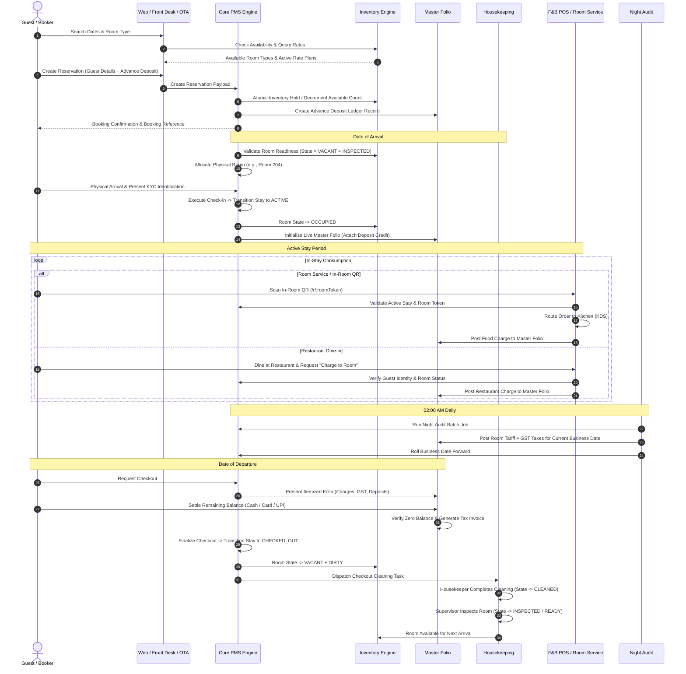

# 01-PRODUCT-REQUIREMENTS-AND-SCOPE.md
# TapMenu HMS — Product Requirements, Scope Boundaries & Core Hotel Lifecycle

---

## 1. Document Control & Metadata
- **Document Identifier:** `DOC-HMS-001`
- **System Name:** TapMenu HMS
- **Version:** 2.0.0
- **Document Status:** Implementation-Ready Engineering Specification
- **Primary Source:** `TapMenu_HMS_Final_Client_Specification(1).docx` (Sections 1, 2, 3, 23, 27, 28)
- **Traceability Tag:** `FR-PROD-*`, `BR-PROD-*`, `NFR-PROD-*`

---

## 2. Product Scope & Phased Capability Boundaries

### 2.1 Core MVP Scope (Initial Implementation)
`[SOURCE REQUIREMENT]`
The initial production release delivers a complete, self-contained Property Management System, operational Front Desk, Unified Inventory, Master Folio Billing, Housekeeping/Maintenance engine, and F&B POS/KDS.

1. **PMS Foundation & Multi-Source Reservations:** Walk-in, direct call/phone, direct website booking API, corporate, and travel agent reservations.
2. **Interactive Visual Calendar:** Drag-and-drop timeline grid with real-time conflict validation and room state visibility.
3. **Room Inventory & Rate Engine:** Dynamic room types, physical rooms, seasonal rate plans, extra guest pricing, and availability calculation.
4. **Front Desk & Stay Management:** Smart room allocation, guest registration with KYC document upload, check-in, room moves, stay extensions, early/late checkout, and checkout.
5. **Guest 360 Profile:** Contact management, stay history, spend tracking, guest preferences, VIP tier tagging, and duplicate resolution.
6. **Master Folio & Financial Billing:** Unified guest ledger accumulating room tariffs, F&B orders, laundry, minibar, and airport transfer debits; split folios; advance deposits; payment processing; Indian GST calculation; and invoice generation.
7. **Shift Reconciliation & Night Audit:** Cashier shift open/close, expected vs. actual cash balancing, automatic room tariff posting, and business date rollover.
8. **Housekeeping & Maintenance Operations:** Mobile-first housekeeping interface, cleaning task queues (daily, checkout, deep-cleaning), supervisor inspection workflows, and maintenance ticketing with photo capture.
9. **F&B POS & Kitchen Display (KDS):** Table layout floor plan, counter billing, kitchen station routing, thermal printing support, in-room QR digital menu ordering, and charge-to-room folio posting.
10. **Executive & Operations Dashboards:** Real-time occupancy, expected arrivals/departures, room status matrix, ADR, RevPAR, and revenue breakdown.
11. **Channel Manager Integration Architecture:** Adapter-based abstraction ready to synchronize ARI and bookings with external channels.
12. **Multi-Property Core:** Organizational tenant model supporting property-level data isolation and role assignment.

### 2.2 Phase 2 Scope (Post-MVP Enhancements)
`[SOURCE REQUIREMENT]` & `[PROPOSED]`
1. **Live OTA Bidirectional Sync:** Production deployment of channel adapters for Booking.com, Agoda, MakeMyTrip, and Airbnb via OTA APIs or switch providers.
2. **Automated Guest Communication:** Automated transactional triggers for WhatsApp, SMS, and Email (booking confirmation, pre-arrival registration, checkout receipts).
3. **F&B Recipe Costing & Inventory Deductions:** Bill of Materials (BOM) ingredient deduction upon order fulfillment and low-stock alerts.
4. **Linen & Minibar Advanced Tracking:** Soiled/clean linen dispatch cycles to external laundry vendors; automated minibar restock orders.

### 2.3 Future Scope (Strategic Enhancements)
`[SOURCE REQUIREMENT]`
1. Native iOS/Android mobile apps for hotel guests.
2. Guest loyalty and rewards points engine.
3. Advanced CRM with automated marketing segmentation.
4. AI-driven conversational front desk and guest concierge assistant.
5. Dynamic algorithmic revenue management and automated price optimization.
6. Hardware integrations for biometric door locks, RFID key-card encoders, and PBX telephone billing.
7. Enterprise ERP/accounting bi-directional synchronization (Tally, SAP, Oracle NetSuite).
8. Global Distribution System (GDS) connectivity.

### 2.4 Out-of-Scope (Deliberately Excluded)
`[ENGINEERING DECISION]`
1. Standalone payroll, time-card biometric punch clock calculation, and human resources legal administration.
2. Direct airline flight ticketing or standalone car rental fleet management outside of fixed hotel transfer billing.
3. Native e-commerce marketplace for third-party retail vendors.

---

## 3. Core Hotel Operational Lifecycle

Every guest interaction and inventory state transition in TapMenu HMS follows this strictly orchestrated sequence:



---

## 4. End-to-End User Journeys

### 4.1 Journey 1: Direct Website Guest Booking
```
[Guest opens direct website]
       │
       ▼
[Selects Dates & Guests] ──► [Invokes GET /api/v1/availability]
       │
       ▼
[Selects Deluxe King & Bed & Breakfast Rate Plan]
       │
       ▼
[Enters Contact, Names, Special Requests]
       │
       ▼
[Processes Advance Deposit via Online Payment Gateway]
       │
       ▼
[HMS creates Confirmed Reservation + Atomically updates Inventory + Emits Confirmation Email/WhatsApp]
```

### 4.2 Journey 2: Front Desk Walk-In
```
[Unannounced Guest arrives at Front Desk]
       │
       ▼
[Front Desk Agent opens "Walk-In" Screen on HMS]
       │
       ▼
[System displays real-time available rooms for today]
       │
       ▼
[Agent selects Room 104, enters Guest Name, Phone, and scans Passport/Aadhaar]
       │
       ▼
[System collects full payment or pre-authorization deposit via Card/UPI/Cash]
       │
       ▼
[Agent clicks "Check-In Now"]
       │
       ▼
[System transitions Room 104 to OCCUPIED, issues physical key, and activates in-room QR token]
```

### 4.3 Journey 3: In-Room Dining & Charge-to-Room
```
[Guest in Room 204 scans bedside QR code]
       │
       ▼
[Mobile browser opens https://hotel.app/r/{roomToken}]
       │
       ▼
[System validates active stay for Room 204; displays Room Service Menu]
       │
       ▼
[Guest adds Club Sandwich & Fresh Juice to cart -> Clicks "Order & Charge to Room"]
       │
       ▼
[Order routes instantly to Kitchen KDS (Sandwich station) & Bar KDS (Juice station)]
       │
       ▼
[Order total + 5% F&B GST posted atomically as debit line item to Room 204 Master Folio]
```

### 4.4 Journey 4: Departure Settlement & Room Turnover
```
[Guest approaches Front Desk to check out]
       │
       ▼
[Agent reviews Room 204 Master Folio: ₹19,500 Room + ₹1,450 F&B - ₹5,000 Advance = ₹15,950 Due]
       │
       ▼
[Guest pays ₹15,950 via Split Tender: ₹10,000 Card + ₹5,950 UPI]
       │
       ▼
[Folio balance reaches ₹0.00; System seals Folio and prints sequential GST Tax Invoice]
       │
       ▼
[Agent clicks "Complete Checkout"]
       │
       ▼
[Room 204 status automatically flips to VACANT + DIRTY]
       │
       ▼
[Housekeeping mobile board updates: High-priority checkout cleaning task queued for Room 204]
```

---

## 5. Detailed Functional Requirements Specification

### 5.1 Module: Property & Room Inventory

#### FR-ROOM-001: Physical Room & Room Type Configuration
- **Requirement ID:** `FR-ROOM-001`
- **Description:** `[SOURCE REQUIREMENT]` The system must allow administrators to configure floors, room types, and physical rooms with designated base capacities, extra adult/child allowances, and physical amenities.
- **Actor:** General Manager, Administrator
- **Preconditions:** Authenticated user with `PROPERTY_MANAGE` permission.
- **Main Flow:**
  1. Actor navigates to Property Settings > Rooms.
  2. Actor creates a Room Type (e.g., "Deluxe Suite", Max Adult: 3, Max Child: 2, Base Rate: ₹4,500).
  3. Actor adds physical rooms mapped to this room type, specifying floor number, wing, and room number.
  4. System validates that room numbers are unique within the property.
  5. System saves records and initializes inventory state to `VACANT_DIRTY`.
- **Alternative Flow:** Actor bulk-creates rooms across a floor range (e.g., Rooms 101–120).
- **Failure Flow:** Duplicate room number entered; system rejects with `409 Conflict`.
- **Business Rules:** `BR-ROOM-001` (Every physical room must belong to exactly one room type).
- **Security:** Requires `PROPERTY_MANAGE` role; fully audited under `SEC-AUDIT-001`.
- **Data Impact:** Inserts into `room_types`, `rooms`, `amenities`.
- **API Impact:** `POST /api/v1/properties/{id}/room-types`, `POST /api/v1/properties/{id}/rooms`.
- **UI Impact:** Property Settings Room Builder with dynamic floor mapping.
- **Acceptance Criteria:** Given valid floor and room number, when created, room appears in Room Matrix and sellable counts update.

---

#### FR-ROOM-002: Room State Transition Management
- **Requirement ID:** `FR-ROOM-002`
- **Description:** `[SOURCE REQUIREMENT]` The system must enforce the deterministic room state machine across housekeeping, front desk, and maintenance events.
- **Actor:** Front Desk Agent, Housekeeper, Housekeeping Supervisor, Maintenance Engineer
- **Preconditions:** Room exists in active property.
- **Main Flow:**
  1. Room transitions from `DIRTY` to `IN_CLEANING` when housekeeper taps "Start Cleaning".
  2. Housekeeper taps "Complete"; room transitions to `CLEANED`.
  3. Supervisor inspects room; approves condition; room transitions to `INSPECTED` (sellable/ready).
  4. Front desk checks in guest; room transitions to `OCCUPIED`.
  5. Front desk checks out guest; room transitions automatically to `DIRTY`.
- **Alternative Flow (Maintenance):** Any authorized staff flags a defect; room transitions to `OUT_OF_ORDER` (OOO) or `OUT_OF_SERVICE` (OOS), blocking check-in.
- **Failure Flow:** Front desk attempts to check in a guest to a room in `DIRTY`, `IN_CLEANING`, or `OOO` state. System blocks check-in with `422 Unprocessable Entity` ("Room not ready for check-in").
- **Business Rules:** `BR-ROOM-002` (Only rooms in `INSPECTED` or manager-overridden `CLEANED` state can be checked in).
- **Security:** Enforced in backend service layer.
- **Data Impact:** Updates `rooms.status` and appends to `room_status_history`.
- **API Impact:** `PATCH /api/v1/rooms/{id}/status`.
- **UI Impact:** Real-time visual badge update on Room Matrix and Calendar.
- **Acceptance Criteria:** Attempting to assign or check in an uninspected room without supervisor override fails with an explicit validation error.

---

### 5.2 Module: Reservations & Availability

#### FR-RES-001: Multi-Source Reservation Creation
- **Requirement ID:** `FR-RES-001`
- **Description:** `[SOURCE REQUIREMENT]` The system must ingest and create reservations from direct website, phone/walk-in, corporate accounts, travel agents, and OTA channels into a single unified schema.
- **Actor:** Guest (Website), Front Desk Agent, Channel Manager Adapter
- **Preconditions:** Requested room type has verified sellable inventory for the entire date range.
- **Main Flow:**
  1. Booker submits check-in date, check-out date, room type ID, rate plan ID, guest count, and primary guest details.
  2. System executes atomic inventory check within a database transaction.
  3. System creates a reservation in `CONFIRMED` status (or `PENDING` if awaiting deposit).
  4. System decrements sellable inventory for each calendar date in the stay.
  5. System creates an advance deposit ledger entry if payment is attached.
  6. System returns a unique booking reference (e.g., `RES-2026-1042`).
- **Alternative Flow:** Booker selects multiple rooms in a single booking request; system allocates inventory atomically across all requested units.
- **Failure Flow (Race Condition):** Two bookers attempt to book the final available room simultaneously. First transaction commits; second transaction encounters zero inventory and aborts with `409 Conflict` (`ROOM_NOT_AVAILABLE`).
- **Business Rules:** `BR-INV-001` (Last-room concurrency protection via database locking).
- **Security:** Public website booking uses rate-limiting and captcha/idempotency keys; staff booking requires `RESERVATION_CREATE` permission.
- **Data Impact:** Inserts into `reservations`, `reservation_rooms`, `reservation_guests`, `stay_events`.
- **API Impact:** `POST /api/v1/reservations`.
- **UI Impact:** Reservation Create Modal / Booking Engine checkout step.
- **Acceptance Criteria:** Concurrent booking attempts for the last room result in exactly 1 confirmation and 1 clear rejection; no overbooking occurs.

---

#### FR-RES-002: Visual Calendar Timeline Operations
- **Requirement ID:** `FR-RES-002`
- **Description:** `[SOURCE REQUIREMENT]` Front desk staff must interact with reservations, room statuses, and availability via an interactive, drag-and-drop visual timeline grid.
- **Actor:** Front Desk Agent, Reservation Manager
- **Preconditions:** User authenticated with `RESERVATION_VIEW` permission.
- **Main Flow:**
  1. User views grid with physical rooms as rows and calendar dates as columns.
  2. Reservation blocks display guest name, reservation code, payment status, and VIP badge.
  3. User drags a reservation block to another room or adjusts date bounds.
  4. System executes backend validation: room readiness, room type rate discrepancies, and conflicting bookings.
  5. If valid, system updates room assignment and logs the movement.
- **Alternative Flow:** User clicks on an empty cell; system opens Reservation Creation modal pre-filled with selected room and date.
- **Failure Flow:** User drags a reservation into an occupied, OOO, or overlapping date slot. UI snaps back to original position and displays an error toast.
- **Business Rules:** `BR-RES-002` (Room moves must validate target room cleanliness and occupancy).
- **Security:** Moving reservations between different room types with price variations requires `RATE_OVERRIDE` or manager approval.
- **Data Impact:** Updates `reservation_rooms.room_id`.
- **API Impact:** `PATCH /api/v1/reservations/{id}/assign-room`.
- **UI Impact:** FullCalendar timeline view with custom resource rendering.
- **Acceptance Criteria:** Dragging a reservation to a conflicting slot is prevented with an immediate visual and API error; no database collision.

---

### 5.3 Module: Front Desk & Stay Management

#### FR-FD-001: Guest Check-in & ID/KYC Registration
- **Requirement ID:** `FR-FD-001`
- **Description:** `[SOURCE REQUIREMENT]` Front desk agents must record mandatory guest identification documents, verify contact details, and execute check-in, converting the reservation into an active stay.
- **Actor:** Front Desk Agent
- **Preconditions:** Reservation exists in `CONFIRMED` state; arrival date is today (or early check-in approved); assigned room is in `INSPECTED` status.
- **Main Flow:**
  1. Agent searches reservation by guest name, phone, or booking reference.
  2. Agent uploads or captures guest KYC document (Aadhaar, Passport, Driving License) and records document number.
  3. Agent confirms assigned physical room.
  4. Agent processes check-in.
  5. System transitions stay status to `CHECKED_IN`, room status to `OCCUPIED`, initializes master folio, and generates secure in-room QR token.
- **Alternative Flow (Unassigned Room):** If reservation had no pre-assigned room, system displays available clean rooms matching the booked room type for immediate assignment.
- **Failure Flow:** Assigned room is in `DIRTY` or `MAINTENANCE` state. System prompts: "Room not inspected. Assign different room or request manager override."
- **Business Rules:** `BR-FD-001` (Check-in prohibited without at least one primary guest KYC document uploaded or verified).
- **Security:** Uploaded identity documents stored in private S3 bucket with expiring presigned URLs (15-min TTL, zero public access); access logged in audit log.
- **Data Impact:** Inserts into `check_ins`, `stays`, `guest_documents`; updates `stays.status` to `CHECKED_IN`, `rooms.status` to `OCCUPIED`.
- **API Impact:** `POST /api/v1/check-ins`.
- **UI Impact:** Front Desk Check-in Wizard with webcam/file upload support.
- **Acceptance Criteria:** Successful check-in generates active stay record, locks room as occupied, and enables in-room QR ordering.

---

#### FR-FD-002: Guest Checkout & Settlement Verification
- **Requirement ID:** `FR-FD-002`
- **Description:** `[SOURCE REQUIREMENT]` Front desk agents must review the master guest folio, collect any outstanding balance, issue an official GST invoice, and transition the room to housekeeping turnover.
- **Actor:** Front Desk Agent, Cashier
- **Preconditions:** Stay is in `CHECKED_IN` state.
- **Main Flow:**
  1. Agent accesses departure screen and selects Room 204.
  2. System calculates live balance: `Total Debits - Total Credits`.
  3. If balance > 0, agent processes settlement via Cash, Card, UPI, or Bill-to-Company.
  4. Once balance is exactly zero, system finalizes folio, locks further postings, and issues a sequentially numbered GST Tax Invoice.
  5. Agent clicks "Complete Checkout".
  6. Room status immediately transitions to `DIRTY`.
  7. System dispatches a `HOUSEKEEPING_CHECKOUT_CLEAN` task to the housekeeping queue.
  8. If all rooms under the parent reservation are checked out and folios settled, parent reservation transitions to `COMPLETED`.
- **Alternative Flow (Refund Due):** If advance deposits exceed charges, system issues a refund transaction with mandatory manager authorization.
- **Failure Flow:** Agent attempts checkout while folio balance is non-zero. System aborts checkout with `422 Unprocessable Entity` ("Cannot check out with non-zero folio balance").
- **Business Rules:** `BR-FOLIO-002` (Zero-balance rule for folio closure).
- **Security:** Requires `CHECKOUT_PROCESS` permission; refunds require `REFUND_EXECUTE` permission.
- **Data Impact:** Updates `stays.status` to `CHECKED_OUT`, `reservations.status` to `COMPLETED` (if last stay), `master_folios.status` to `CLOSED`, `rooms.status` to `DIRTY`; inserts `housekeeping_tasks`.
- **API Impact:** `POST /api/v1/check-outs`.
- **UI Impact:** Checkout modal showing itemized folio review, payment split options, and printable invoice preview.
- **Acceptance Criteria:** Folio cannot be closed with an open balance; completing checkout immediately changes room state to `DIRTY` on housekeeping boards.

---

### 5.4 Module: Housekeeping & Maintenance

#### FR-HK-001: Mobile Housekeeping Task Board
- **Requirement ID:** `FR-HK-001`
- **Description:** `[SOURCE REQUIREMENT]` Housekeeping staff must receive, view, and update cleaning tasks in real time via a lightweight, touch-optimized mobile interface.
- **Actor:** Housekeeper, Housekeeping Supervisor
- **Preconditions:** User authenticated with `HOUSEKEEPING_STAFF` or `HOUSEKEEPING_SUPERVISOR` role.
- **Main Flow:**
  1. Housekeeper views personalized list of assigned rooms sorted by priority (Checkout clean > Stayover clean > Deep clean).
  2. Housekeeper taps "Start Cleaning" on Room 102; room status updates to `IN_CLEANING`.
  3. Housekeeper completes cleaning and taps "Mark Cleaned"; room status updates to `CLEANED`.
  4. Supervisor receives notification; inspects room; taps "Approve Inspection".
  5. Room status updates to `INSPECTED / READY` and becomes immediately eligible for front-desk check-in.
- **Alternative Flow (Failed Inspection):** Supervisor rejects cleaning; room reverts to `DIRTY` with supervisor notes.
- **Failure Flow:** Network disconnects during mobile update; PWA service worker caches action and resynchronizes upon reconnection.
- **Business Rules:** `BR-HK-001` (Supervisor inspection mandatory before room enters sellable ready pool).
- **Security:** Housekeeper cannot access financial or guest PII data outside of room number and occupancy state.
- **Data Impact:** Updates `housekeeping_tasks`, `rooms.status`, `room_status_history`.
- **API Impact:** `PATCH /api/v1/housekeeping/tasks/{id}/status`.
- **UI Impact:** Mobile-first card list with 1-tap state buttons.
- **Acceptance Criteria:** Marking a room inspected immediately updates front desk calendar and allows check-in without manual phone calls.

---

#### FR-MAINT-001: Maintenance Ticketing & Room Blocking
- **Requirement ID:** `FR-MAINT-001`
- **Description:** `[SOURCE REQUIREMENT]` Staff must report maintenance issues with photos, track resolution SLAs, and optionally block rooms from inventory as OOO or OOS.
- **Actor:** Any Staff Member (Reporter), Maintenance Engineer (Assignee), General Manager
- **Preconditions:** User authenticated with appropriate operational role.
- **Main Flow:**
  1. Staff discovers AC leakage in Room 305; creates ticket: Category = HVAC, Priority = HIGH, attaches photo.
  2. Staff checks "Block Room as Out of Order (OOO)".
  3. System updates Room 305 to `OUT_OF_ORDER`, decrements sellable inventory, and removes room from available calendar slots.
  4. Maintenance engineer fixes AC, uploads resolution photo, and marks ticket `RESOLVED`.
  5. Room transitions to `DIRTY` (requiring post-maintenance cleaning) or `INSPECTED`.
- **Alternative Flow:** Issue is cosmetic; staff sets room to `OUT_OF_SERVICE` (OOS). Inventory counts reflect availability hold, but property capacity is not reduced.
- **Failure Flow:** Staff attempts to set an `OCCUPIED` room to `OOO` without relocating guest. System rejects request.
- **Business Rules:** `BR-MAINT-001` (Occupied rooms cannot be set to OOO; guest relocation required first).
- **Security:** Setting a room to OOO requires `MAINTENANCE_MANAGE` or `FRONT_DESK_SUPERVISOR`.
- **Data Impact:** Inserts `maintenance_tickets`, updates `rooms.status`.
- **API Impact:** `POST /api/v1/maintenance/tickets`, `PATCH /api/v1/maintenance/tickets/{id}`.
- **UI Impact:** Maintenance ticketing dashboard with photo gallery and downtime tracker.
- **Acceptance Criteria:** Setting room to OOO immediately removes it from sellable counts across all channels and prevents front desk allocation.

---

### 5.5 Module: F&B POS, KDS & Room Service

#### FR-POS-001: Restaurant Table & Order Management
- **Requirement ID:** `FR-POS-001`
- **Description:** `[SOURCE REQUIREMENT]` Restaurant cashiers must manage table layouts, take dining orders, modify items, and route kitchen tickets to KDS stations.
- **Actor:** Restaurant Server, F&B Cashier
- **Preconditions:** Restaurant outlet configured; tables defined.
- **Main Flow:**
  1. Cashier selects Table T4 on interactive floor plan.
  2. Cashier adds menu items, selects modifiers (e.g., "Medium Spicy", "No Onion").
  3. Cashier taps "Send to Kitchen".
  4. System routes items to designated KDS stations (Main Kitchen vs. Bar) and prints physical thermal KOT if configured.
  5. Table status updates to `ORDERED`.
- **Alternative Flow (Bill Settlement):** Cashier prints bill; guest pays via Cash/Card/UPI; table status flips to `AVAILABLE`.
- **Failure Flow:** Item out of stock; system displays warning badge and blocks item addition.
- **Business Rules:** `BR-POS-001` (Every order item must have a valid tax rate and menu category).
- **Security:** Voiding an order item after sending to kitchen requires `POS_VOID` supervisor permission.
- **Data Impact:** Inserts into `orders`, `order_items`, `kds_tickets`.
- **API Impact:** `POST /api/v1/pos/orders`.
- **UI Impact:** Touch-first POS grid with visual table map and menu category tabs.
- **Acceptance Criteria:** Submitting order updates KDS screens in < 500ms via WebSockets.

---

#### FR-POS-002: In-Room QR Dining & Charge-to-Room
- **Requirement ID:** `FR-POS-002`
- **Description:** `[SOURCE REQUIREMENT]` Guests must be able to scan an in-room QR code, view the room service menu, order without app installation, and either pay online or charge directly to their master folio.
- **Actor:** Hotel Guest
- **Preconditions:** Room is `OCCUPIED` with an `ACTIVE` stay.
- **Main Flow:**
  1. Guest scans bedside QR code containing signed room token: `/r/:roomToken`.
  2. Mobile web app opens, validates active stay, and displays digital room service menu.
  3. Guest adds dishes to cart and selects "Charge to Room".
  4. System validates that room stay is active and folio credit limit is not exceeded.
  5. System generates an order, dispatches KDS tickets, and posts debit line item to Room Master Folio.
  6. Guest sees live preparation status on screen ("Kitchen Preparing" -> "Out for Delivery").
- **Alternative Flow (Pay Now):** Guest opts to pay immediately via UPI/Razorpay; charge is settled directly and does not add to folio outstanding balance.
- **Failure Flow:** Guest scans QR after checkout or room is vacant; system displays friendly error: "No active stay found for this room. Please contact front desk."
- **Business Rules:** `BR-POS-002` (Charge-to-room strictly restricted to verified active stays within approved credit limit).
- **Security:** Room token is cryptographically signed (HMAC-SHA256) and invalidated upon checkout.
- **Data Impact:** Inserts `orders`, `order_items`; inserts `folio_line_items`.
- **API Impact:** `POST /api/v1/guest/orders`.
- **UI Impact:** Responsive mobile guest web application.
- **Acceptance Criteria:** Expired or tampered room tokens cannot post charges; valid orders appear on master folio instantly.

---

### 5.6 Module: Master Folio, Billing & Indian GST

#### FR-FOLIO-001: Unified Folio Ledger & Split Billing
- **Requirement ID:** `FR-FOLIO-001`
- **Description:** `[SOURCE REQUIREMENT]` The system must maintain an immutable ledger aggregating all room and ancillary charges, supporting split folios between corporate tariffs and personal incidentals.
- **Actor:** Front Desk Cashier, Accountant
- **Preconditions:** Active stay exists.
- **Main Flow:**
  1. User opens Room Folio.
  2. User creates Sub-Folio B ("Personal Incidentals").
  3. User moves restaurant and minibar charges from Folio A to Folio B, leaving room tariff on Folio A.
  4. Folio A is assigned to Bill-to-Company (Corporate Account); Folio B is settled directly by the guest.
  5. System recalculates balances for both folios independently.
- **Alternative Flow:** Guest requests manager discount; manager inputs discount percentage with mandatory reason text; system logs audit trail.
- **Failure Flow:** Attempting to delete a posted line item directly; system blocks deletion (only reversals/adjustments permitted).
- **Business Rules:** `BR-FOLIO-001` (Financial immutability: zero direct deletion of ledger items).
- **Security:** Split transfers, discounts, and write-offs require `FOLIO_ADJUST` role and supervisor approval.
- **Data Impact:** Inserts `folio_adjustments`, updates `folio_line_items.folio_id`.
- **API Impact:** `POST /api/v1/folios/{id}/split`, `POST /api/v1/folios/{id}/adjustments`.
- **UI Impact:** Dual-pane drag-and-drop folio ledger management screen.
- **Acceptance Criteria:** All debits, credits, and adjustments maintain mathematical parity; ledger history is fully preserved.

---

#### FR-TAX-001: Indian GST Hospitality Tax Calculation
- **Requirement ID:** `FR-TAX-001`
- **Description:** `[SOURCE REQUIREMENT]` The system must calculate CGST, SGST, or IGST dynamically based on service category (SAC/HSN), declared room tariff slabs, and property/guest state codes.
- **Actor:** System Billing Engine, Accountant
- **Preconditions:** Property GSTIN and state code configured; tax slabs configured.
- **Main Flow:**
  1. Room tariff line item generated at ₹8,500/night.
  2. Engine evaluates accommodation tax rule (> ₹7,500/night slab = 18% GST).
  3. If guest GSTIN state code matches property state code: generates CGST @ 9% and SGST @ 9%.
  4. If guest GSTIN state code differs: generates IGST @ 18%.
  5. All monetary calculations executed in integer minor units (paise) with half-up rounding.
- **Alternative Flow (F&B / Restaurant Service):** F&B charges evaluated under SAC 996331 at standalone 5% GST without input tax credit (or configured rate).
- **Failure Flow:** Invalid GSTIN format supplied; system flags error and falls back to B2C intra-state tax calculation.
- **Business Rules:** `BR-TAX-001` (Configurable tax rules; no hardcoded permanent rates).
- **Security:** Modifying tax rules restricted strictly to Super Admin.
- **Data Impact:** Inserts into `folio_line_item_taxes`, `invoices`.
- **API Impact:** Integrated into `POST /api/v1/folios/{id}/post-charge`.
- **UI Impact:** Invoice preview with distinct SAC codes, taxable values, CGST/SGST/IGST breakdowns, and corporate GSTIN display.
- **Acceptance Criteria:** GST calculations match Indian tax compliance rules exactly to the paisa; inter-state vs. intra-state logic validated automatically.

---

### 5.7 Module: Night Audit & Financial Rollover

#### FR-AUDIT-001: Day-End Reconciliation & Business Date Advance
- **Requirement ID:** `FR-AUDIT-001`
- **Description:** `[SOURCE REQUIREMENT]` The night auditor must reconcile daily cashier transactions, balance expected vs. counted cash, post room tariffs, and advance the hotel business date.
- **Actor:** Night Auditor, General Manager
- **Preconditions:** User authenticated with `NIGHT_AUDIT_EXECUTE` role; scheduled operational time (typically 02:00 AM).
- **Main Flow:**
  1. Auditor triggers Night Audit wizard.
  2. Step 1: System checks for pending arrivals; auditor marks remaining as `NO_SHOW` or extends reservation.
  3. Step 2: System checks unposted F&B orders and unclosed cashier shifts; prompts for closure.
  4. Step 3: Cash drawer reconciliation: auditor enters counted cash; system calculates over/short variance.
  5. Step 4: System posts room tariff and taxes for all active stays for the current business date.
  6. Step 5: System generates daily trial balance, manager flash report, and rolls business date: `current_business_date = current_business_date + 1 day`.
- **Alternative Flow:** Discrepancy detected in online payment gateway settlement; system logs exception and prompts auditor for sign-off note before proceeding.
- **Failure Flow:** Database lock failure during batch posting; transaction rolls back completely without advancing business date.
- **Business Rules:** `BR-AUDIT-001` (Business date advances only if all required reconciliation steps pass).
- **Security:** Requires high-privilege `NIGHT_AUDIT_EXECUTE` permission; all steps recorded in tamper-evident audit logs.
- **Data Impact:** Updates `property_settings.current_business_date`; inserts batch records in `folio_line_items`, `night_audit_records`.
- **API Impact:** `POST /api/v1/night-audit/run`.
- **UI Impact:** Multi-step Night Audit Wizard with live progress indicators and report downloads.
- **Acceptance Criteria:** System successfully posts room charges to all active folios and cleanly advances the business date without data corruption.

---

## 6. Non-Functional Requirements (NFR)

| NFR ID | Category | Metric / Specification | Traceability / Rationale |
| :--- | :--- | :--- | :--- |
| **NFR-PERF-001** | Performance | Operational API response times < 200ms (P95) under standard concurrency. | Fast front-desk operations during morning rush. |
| **NFR-PERF-002** | Concurrency | Zero double-bookings during simultaneous last-room booking attempts. | High-frequency flash booking race safety (`BR-INV-001`). |
| **NFR-REL-001** | Reliability | Automated PostgreSQL daily backups with 15-minute Point-In-Time-Recovery (PITR). | Disaster recovery and financial data loss prevention. |
| **NFR-SEC-001** | Security | Role-Based Access Control enforced strictly in FastAPI backend; zero client-side security trust. | Protection of financial, guest KYC, and operational records. |
| **NFR-SEC-002** | Security | Cryptographic storage of passwords (Argon2id/Bcrypt) and zero storage of raw credit card PAN/CVV. | Compliance with PCI-DSS guidelines and security best practices. |
| **NFR-A11Y-001** | Usability | Housekeeping and KDS interfaces fully responsive and operable on mobile/tablet touchscreens. | Field usability in room corridors and kitchen heat. |

---

## 7. Client Discovery & Business Decisions Checklist

`[CLIENT DECISION REQUIRED]`
The following operational parameters must be configured during onboarding before production deployment:

1. **Property Master Details:** Property Legal Name, Registered Business Address, Property State Code, and GSTIN.
2. **Inventory Configuration:** Total physical room count, exact floor plans, room numbering scheme, and room type categories.
3. **Operational Timings:** Standard check-in time (e.g., 14:00), standard checkout time (e.g., 11:00), and night audit rollover time (e.g., 02:00 AM).
4. **Tariff & Early/Late Policy:** Half-day charge cutoff hours and early check-in tariff rules.
5. **No-Show Policy:** Guarantee cutoff hour (e.g., 18:00) and retention charge penalty (e.g., 1 night's tariff).
6. **Payment Gateway Provider:** Final selection of online aggregator (Razorpay, Pine Labs, Paytm, or Stripe).
7. **Communication Credentials:** Selection and credentials for WhatsApp Business API, SMS Gateway, and SMTP Provider.
