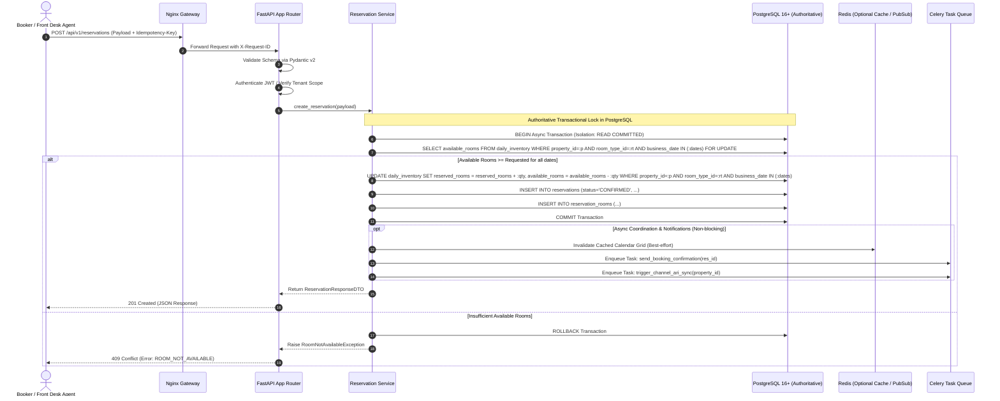

# 02-SYSTEM-ARCHITECTURE-AND-TECH-STACK.md
# TapMenu HMS — System Architecture, Modular Monolith & Technology Stack Specification

---

## 1. Document Control & Metadata
- **Document Identifier:** `DOC-HMS-002`
- **System Name:** TapMenu HMS
- **Version:** 2.0.0
- **Document Status:** Implementation-Ready Architectural Specification
- **Primary Source:** `TapMenu_HMS_Final_Client_Specification(1).docx` (Sections 1, 19, 20, 22)
- **Traceability Tag:** `ARCH-SYS-*`, `TECH-STACK-*`

---

## 2. Core Architectural Philosophy & Inviolable Principles

### 2.1 The Modular Monolith Pattern
`[SOURCE REQUIREMENT]` & `[ENGINEERING DECISION]`
TapMenu HMS is deliberately architected as an **API-First Modular Monolith**. 

1. **Why Modular Monolith Over Microservices:**
   - Hotel operations require strict transactional atomicity across domains (e.g., checkout simultaneously settles a folio, updates room state to dirty, generates a sequential tax invoice, and dispatches a housekeeping task).
   - Distributed transactions (2PC, Saga) across microservices introduce severe data inconsistency risks, latency penalties, and operational overhead that are wholly unjustified for hotel properties.
   - All domains (Front Desk, Housekeeping, POS, Folio, Inventory) reside in a single codebase with strictly defined, enforced internal module boundaries and shared relational transaction managers.

2. **Inviolable Architectural Rules:**
   - **PostgreSQL is the Sole Transactional Source of Truth:** `[SOURCE REQUIREMENT]` Every inventory count, financial balance, room state, and reservation record must be committed transactionally in PostgreSQL.
   - **Authoritative Database Concurrency Control:** `[ENGINEERING DECISION]` Reservation correctness, inventory decrementing, and overbooking prevention rely **exclusively** on PostgreSQL transactions with row-level locking (`SELECT ... FOR UPDATE`) and database check constraints on the materialized `daily_inventory` table.
   - **Redis is Cache, Queue & Optional Coordination Only:** `[SOURCE REQUIREMENT]` & `[ENGINEERING DECISION]` Redis is strictly utilized for transient read-model caching, Celery task message broking, and optional distributed coordination. **Reservation correctness must never depend on Redis availability.** If Redis crashes, restarts, or is uninstalled, core hotel booking and front-desk workflows remain 100% operational through direct PostgreSQL transactions.
   - **External OTAs are Integrations, Not Inventory Authorities:** `[SOURCE REQUIREMENT]` External channels (Booking.com, Agoda) receive availability from the HMS and push bookings into the HMS. They never dictate room counts.
   - **The Hotel Website is an API Consumer:** `[SOURCE REQUIREMENT]` The public direct website consumes standard public HMS REST endpoints. It holds no independent inventory truth.

### 2.2 Architectural Anti-Patterns (Explicitly Prohibited)
- `PROHIBITED:` Microservices or independent deployable services communicating over internal HTTP/gRPC.
- `PROHIBITED:` Kafka, Event Sourcing, or CQRS where simple relational transactions and indexed read-models suffice.
- `PROHIBITED:` GraphQL layers introducing unvetted query cascades and N+1 performance bottlenecks.
- `PROHIBITED:` Multiple databases per module. A single PostgreSQL database with schema-level or tenant-scoped isolation is used.
- `PROHIBITED:` Storing currency as IEEE 754 floating-point numbers (`FLOAT`, `DOUBLE`). All currency must be stored as 64-bit integers in minor units (e.g., paise).
- `PROHIBITED:` Hard dependency on Redis for reservation creation or inventory correctness.

---

## 3. Technology Stack Specification

| Tier / Layer | Technology Selected | Version / Standard | Architectural Rationale & Justification |
| :--- | :--- | :--- | :--- |
| **Frontend Framework** | React + TypeScript | React 19 / TS 5.x | Typed, modern component-driven client architecture suited for complex front-desk dashboards and real-time operations. |
| **Frontend Routing** | React Router | React Router v7 | Modern type-safe data loading, nested route layout, and client-side transition protection. |
| **Frontend Build Tool** | Vite | Vite 5.x / 6.x | Fast HMR and optimized production bundling. |
| **UI Components & Styling** | Tailwind CSS + shadcn/ui | Tailwind CSS v4, Radix UI | Modern CSS-first utility design system, accessible primitives, and consistent theme tokens. |
| **Client Global State** | Zustand | Zustand 5.x | Lightweight, boilerplate-free state management for active user sessions, active property selection, and UI preferences. |
| **Server State & Caching** | TanStack Query | TanStack Query v5 | Automatic background refetching, request deduplication, optimistic updates, and cache invalidation. |
| **Calendar Engine** | FullCalendar | FullCalendar v6 | Industry-standard timeline resource grid for multi-room drag-and-drop reservation management. |
| **Forms & Validation** | React Hook Form + Zod | RHF 7.x, Zod 3.x | High-performance, schema-driven form validation matching backend Pydantic contracts. |
| **Backend API Framework** | Python + FastAPI | Python 3.11+, FastAPI 0.110+ | Asynchronous high-performance REST APIs, automatic OpenAPI documentation, and native dependency injection. |
| **ORM & Database Driver** | SQLAlchemy 2.x + Asyncpg | SQLAlchemy 2.0+, Asyncpg | Typed async relational ORM with complete control over transaction boundaries, connection pooling, and raw SQL escapes. |
| **Schema & Validation** | Pydantic v2 | Pydantic 2.6+ | Blazing-fast Rust-based data validation and strict serialization of incoming/outgoing HTTP payloads. |
| **Relational Database** | PostgreSQL | PostgreSQL 16+ | ACID-compliant transactional source of truth, JSONB support for dynamic settings, and robust row-level concurrency locking. |
| **In-Memory Cache & Broker** | Redis | Redis 7.2+ | In-memory key-value caching, optional distributed coordination, and Celery task broker. |
| **Background Task Workers** | Celery | Celery 5.3+ | Robust task queue for asynchronous I/O: PDF generation, emails, WhatsApp messaging, and channel sync. |
| **Object Storage** | S3-Compatible Storage | AWS S3 / MinIO | Scalable, durable object storage for guest KYC documents, audit reports, invoice PDFs, and maintenance images. |
| **Reverse Proxy & Gateway** | Nginx | Nginx 1.25+ (Alpine) | SSL/TLS termination, rate limiting, gzip/brotli compression, and reverse proxy routing to FastAPI and Vite static assets. |
| **Containerization** | Docker + Docker Compose | Docker Engine 25+ | Uniform containerized environments across local development, staging, and production. |
| **Testing Suite** | Pytest + Playwright | Pytest 8.x, Playwright 1.42+ | Complete end-to-end backend integration tests and browser-level front-desk workflow testing. |
| **Monitoring & Logging** | Sentry + Structlog | Sentry SDK, Structlog | Real-time crash reporting, APM performance tracing, and JSON-formatted structured application logging. |

---

## 4. End-to-End System Architecture

```mermaid
flowchart TD
    subgraph Clients["Client Access Surfaces"]
        FD[Front Desk & Management Terminals<br/>Desktop React SPA]
        HK[Housekeeping & Maintenance<br/>Mobile PWA]
        POS[Restaurant POS & KDS Displays<br/>Touchscreen / Tablet SPA]
        QR[Guest In-Room QR Web App<br/>Mobile Browser]
        WEB[Hotel Direct Website<br/>Public Booking Engine]
        OTA[External Channels & OTAs<br/>Booking.com / Agoda / MMT]
    end

    subgraph Perimeter["Perimeter Security & Ingress"]
        NGX[Nginx Reverse Proxy & Gateway<br/>TLS 1.3 | Rate Limiting | Security Headers]
    end

    subgraph Monolith["FastAPI Application Monolith (Stateless App Nodes)"]
        API[API Gateway & Router /api/v1/*]
        AUTH[Auth & RBAC Middleware]
        
        subgraph DomainModules["Internal Domain Modules"]
            MOD_RES[Reservations & Calendar Engine]
            MOD_INV[Room Inventory & Availability Locker]
            MOD_FD[Front Desk & Stay Manager]
            MOD_FOLIO[Master Folio & Indian GST Engine]
            MOD_POS[F&B POS & KDS Order Router]
            MOD_HK[Housekeeping & Operations Engine]
            MOD_MAINT[Maintenance & Asset Manager]
            MOD_CHAN[Channel Manager Adapter Core]
            MOD_AUDIT[Night Audit & Shift Reconciler]
            MOD_BI[Business Intelligence & Analytics]
        end
    end

    subgraph Persistence["Storage & Infrastructure Tier"]
        PG[(PostgreSQL 16+ Primary<br/>ACID Source of Truth)]
        REDIS[(Redis 7.2+<br/>Cache | Celery Broker | Mutex)]
        S3[(S3-Compatible Object Store<br/>KYC Documents | Invoices | Photos)]
    end

    subgraph AsyncTier["Asynchronous Execution Tier"]
        CELERY[Celery Worker Cluster]
        BEAT[Celery Beat Scheduler<br/>Night Audit & Heartbeats]
        
        subgraph WorkerTasks["Background Tasks"]
            TASK_NOTIF[WhatsApp / Email / SMS Dispatch]
            TASK_PDF[Tax Invoice & Report PDF Rendering]
            TASK_CHAN[Channel ARI Sync & Webhook Worker]
            TASK_AUDIT[Daily Night Audit Automated Batch]
        end
    end

    Clients -->|HTTPS / WSS| NGX
    NGX -->|Proxy Pass| API
    API --> AUTH
    AUTH --> DomainModules

    DomainModules -->|Async DB Session| PG
    DomainModules -->|Cache / Mutex Lock| REDIS
    DomainModules -->|Enqueue Job| REDIS
    DomainModules -->|Presigned Upload/Download| S3

    REDIS -->|Task Queue| CELERY
    BEAT -->|Cron Triggers| REDIS
    CELERY --> WorkerTasks
    WorkerTasks -->|Query / Update State| PG
    WorkerTasks -->|Upload Rendered Artifacts| S3
    WorkerTasks -->|Outbound Push| OTA
```

---

## 5. Domain Module Boundaries & Dependency Rules

To prevent spaghetti coupling within the modular monolith, strict boundary rules are enforced at the Python package level:

```
                    ┌────────────────────────┐
                    │      CORE / AUTH       │
                    │ (Users, Roles, Audit)  │
                    └───────────┬────────────┘
                                │
        ┌───────────────────────┼───────────────────────┐
        ▼                       ▼                       ▼
┌──────────────┐        ┌──────────────┐        ┌──────────────┐
│  INVENTORY   │◄───────┤ RESERVATIONS │───────►│  FRONT DESK  │
│  & ROOMS     │        │  & CALENDAR  │        │   & STAYS    │
└───────▲──────┘        └───────┬──────┘        └───────┬──────┘
        │                       │                       │
        │                       ▼                       ▼
        │               ┌──────────────┐        ┌──────────────┐
        │               │ MASTER FOLIO │◄───────┤   F&B POS    │
        │               │  & GST TAX   │        │    & KDS     │
        │               └───────▲──────┘        └──────────────┘
        │                       │
        ├───────────────────────┤
        ▼                       ▼
┌──────────────┐        ┌──────────────┐
│ HOUSEKEEPING │        │ NIGHT AUDIT  │
│& MAINTENANCE │        │& SETTLEMENTS │
└──────────────┘        └──────────────┘
```

### 5.1 Internal Dependency Rules
1. **Unidirectional Dependencies:** Upstream modules must never import downstream modules. Domain modules depend on `Core/Auth` and `Common/Database`, never on each other's private data access objects.
2. **Inter-Module Communication via Service Interfaces:**
   - When the `F&B POS` module posts a charge to a room, it **never** directly inserts a record into the `master_folios` table.
   - It calls the public service interface: `folio_service.post_room_charge(room_id, charge_payload)`.
3. **Shared Database Transactions:** When a business operation spans multiple modules (e.g., `checkout_stay`), all operations execute within a single SQLAlchemy `AsyncSession` transaction block, ensuring absolute atomicity.

---

## 6. Data Flow & Execution Lifecycles

### 6.1 Transactional Request Flow (e.g., Booking Creation)


### 6.2 Redis Usage Specification
`[ENGINEERING DECISION]`
1. **Cache Layer (Non-Authoritative):**
   - `inventory:calendar:{property_id}:{yyyy_mm}` — Fast read cache for visual calendar availability. TTL: 300 seconds, invalidated on any reservation create, cancel, or room status change.
   - `rates:daily:{property_id}:{yyyy_mm_dd}` — Pre-calculated rate matrices for website booking engine.
2. **Optional Coordination Layer:**
   - Optional rate limiting acceleration and WebSocket pub/sub connection tracking. **Never used as an availability prerequisite for transactional booking safety.**
3. **Pub/Sub & WebSockets:**
   - Channel: `ws:kds:{property_id}:{kitchen_station_id}` — Instant order dispatch to Kitchen Display screens.
   - Channel: `ws:frontdesk:{property_id}` — Instant room status updates across front desk calendar screens.
4. **Celery Broker & Result Backend:**
   - Redis Database `0` = Application Cache.
   - Redis Database `1` = Celery Message Broker & Result Storage.

---

## 7. Storage, Documents & S3 Integration Architecture

All unstructured binary files are stored in S3-compatible object storage (AWS S3 or MinIO). The database stores only metadata and file references.

```
┌──────────────────┐               ┌──────────────────┐               ┌──────────────────┐
│  Client Browser  │               │   FastAPI App    │               │  S3 Object Store │
└────────┬─────────┘               └────────┬─────────┘               └────────┬─────────┘
         │                                  │                                  │
         │ 1. POST /api/v1/documents/upload │                                  │
         │─────────────────────────────────►│                                  │
         │                                  │ 2. Generate Presigned URL        │
         │                                  │    with strict Content-Type & TTL│
         │ 3. Return Presigned S3 PUT URL   │◄─────────────────────────────────│
         │◄─────────────────────────────────│                                  │
         │                                                                     │
         │ 4. Direct Upload (PUT binary payload)                               │
         │────────────────────────────────────────────────────────────────────►│
         │                                                                     │
         │ 5. POST /api/v1/documents/confirm (S3 Key, File Size, Checksum)     │
         │─────────────────────────────────►│                                  │
         │                                  │ 6. Verify S3 Object & Save Record│
         │                                  │    in PostgreSQL                 │
         │ 7. Return Verified Document DTO  │                                  │
         │◄─────────────────────────────────│                                  │
```

### Storage Bucket Policies & Encryption
1. **Bucket `hms-guest-documents` (Private):** Stores guest Aadhaar cards, passports, and registration cards. SSE-S3 encryption at rest. Direct public access disabled. Read access strictly via short-lived (15-minute) presigned GET URLs generated only for authorized front-desk agents.
2. **Bucket `hms-invoices-reports` (Private):** Stores generated PDF tax invoices, folio statements, and night audit summary sheets.
3. **Bucket `hms-maintenance-media` (Private):** Stores technician damage photos and resolution evidence.

---

## 8. Scalability, Reliability & High-Availability Strategy

### 8.1 Horizontal App Scaling
- The FastAPI application is completely stateless.
- Multiple instances run behind the Nginx reverse proxy or cloud load balancer (ALB).
- Scaling is horizontal: spinning up additional container replicas satisfies increased web or front-desk concurrency without state sharing issues.

### 8.2 Database Concurrency & Connection Pooling
- PostgreSQL connection pooling is handled via `asyncpg` with bounded pool sizes (Min: 10, Max: 50 connections per app replica).
- High concurrency inventory protection uses row-level locking (`SELECT ... FOR UPDATE`) scoped tightly to specific property and calendar dates, minimizing lock contention.

### 8.3 Disaster Recovery & Fault Tolerance
- **Database Backup Strategy:** Daily automated full snapshots combined with continuous Write-Ahead Log (WAL) archiving for 15-minute Point-In-Time-Recovery (PITR).
- **Graceful Degradation:** If Celery or background messaging is temporarily offline, core PMS operations (check-in, checkout, bill settlement) continue uninterrupted; notifications queue in Redis until workers recover.

---

## 9. Observability & Monitoring Architecture

1. **Structured JSON Logging:**
   - Implemented via `structlog`.
   - Every log record outputs machine-readable JSON containing: `timestamp`, `level`, `service`, `property_id`, `request_id`, `actor_id`, `endpoint`, and `latency_ms`.
2. **Error Tracking & APM (Sentry):**
   - Captures unhandled backend exceptions, database query timeouts, and frontend JavaScript runtime errors.
   - Sensitive user information (passwords, payment numbers, Aadhaar numbers) is filtered out via Sentry scrubbers before transmission.
3. **Health Checks:**
   - Endpoint `/api/v1/health/liveness`: Returns `200 OK` if the Python process is alive.
   - Endpoint `/api/v1/health/readiness`: Queries PostgreSQL (`SELECT 1`) and Redis (`PING`). Returns `503 Service Unavailable` if either backing store is disconnected.
