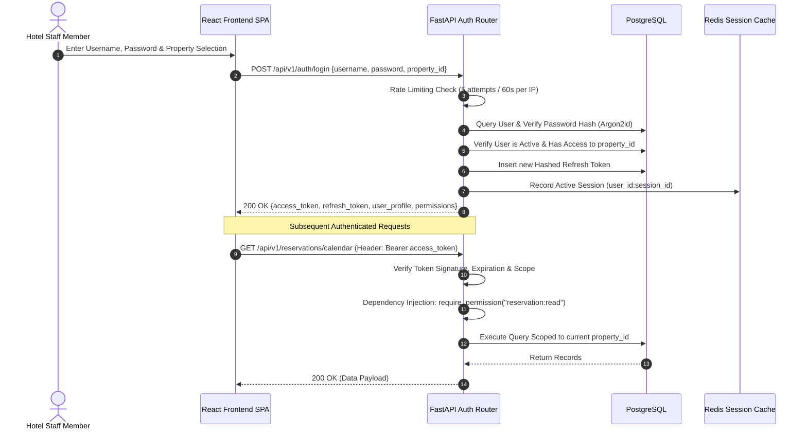

# 03-USERS-RBAC-SECURITY-AND-AUDIT.md
# TapMenu HMS — Users, Role-Based Access Control (RBAC), Security Architecture & Immutable Audit Engine

---

## 1. Document Control & Metadata
- **Document Identifier:** `DOC-HMS-003`
- **System Name:** TapMenu HMS
- **Version:** 2.0.0
- **Document Status:** Implementation-Ready Security Specification
- **Primary Source:** `TapMenu_HMS_Final_Client_Specification(1).docx` (Sections 4, 18)
- **Traceability Tag:** `SEC-AUTH-*`, `SEC-RBAC-*`, `SEC-AUDIT-*`, `SEC-THREAT-*`

---

## 2. Role-Based Access Control (RBAC) Architecture

### 2.1 Core Roles & Operational Scopes
`[SOURCE REQUIREMENT]`
The platform enforces strict Role-Based Access Control with dual-dimensional scoping:
1. **Organizational/Property Scope:** Global (across all properties in an organization) vs. Property-Specific (restricted to one designated branch/hotel).
2. **Departmental Functional Scope:** Granular operational capabilities bound to specific hotel departments.

```
┌─────────────────────────────────────────────────────────────────────────────┐
│ ORGANIZATIONAL ROOT (Organization ID)                                       │
│ └── Super Admin / Hotel Chain Owner                                         │
└──────────────────────────────────────┬──────────────────────────────────────┘
                                       │
            ┌──────────────────────────┴──────────────────────────┐
            ▼                                                     ▼
┌──────────────────────────────────────┐  ┌───────────────────────────────────┐
│ PROPERTY SCOPE: Property A (Jaipur)  │  │ PROPERTY SCOPE: Property B (Goa)  │
│ ├── General Manager                  │  │ ├── General Manager               │
│ ├── Front Desk Agent / Supervisor    │  │ ├── Front Desk Agent / Supervisor │
│ ├── Housekeeper / Supervisor         │  │ ├── Housekeeper / Supervisor      │
│ ├── Maintenance Technician           │  │ ├── Maintenance Technician        │
│ ├── F&B Cashier / Waitstaff          │  │ ├── F&B Cashier / Waitstaff       │
│ ├── Kitchen / KDS Chef               │  │ ├── Kitchen / KDS Chef            │
│ ├── Property Accountant              │  │ ├── Property Accountant           │
│ └── Read-Only Auditor                │  └── Read-Only Auditor               │
└──────────────────────────────────────┘  └───────────────────────────────────┘
```

### 2.2 Standard Role Capability Matrix

| Role Identifier | Functional Category | Default Operational Capabilities | Property Scope |
| :--- | :--- | :--- | :--- |
| `ROLE_SUPER_ADMIN` | Executive / Org | Full unrestricted platform visibility; organization creation, property onboarding, global tax rules, global financial reporting, and tenant security settings. | Global |
| `ROLE_GENERAL_MANAGER` | Management | Full property oversight; managerial overrides for discounts, voids, refunds; rate overrides; room OOO approval; staff management; night audit verification; business reports. | Single Property (or Multi) |
| `ROLE_FRONT_DESK` | Operations | Reservation creation, modification, check-in, checkout, room allocation, key assignment, guest KYC upload, deposit collection, standard folio viewing, and walk-ins. | Single Property |
| `ROLE_HOUSEKEEPING` | Operations | View assigned cleaning tasks, update room cleanliness states (`IN_CLEANING`, `CLEANED`), report maintenance defects, record minibar consumption. | Single Property |
| `ROLE_HOUSEKEEPING_SUPERVISOR`| Operations | Assign rooms to housekeepers, inspect cleaned rooms (`INSPECTED / READY`), reject cleaning with notes, manage linen stock, oversee lost & found. | Single Property |
| `ROLE_MAINTENANCE` | Operations | View and update work orders, mark tickets in progress/resolved, upload repair evidence photos, request room OOO/OOS status. | Single Property |
| `ROLE_FNB_CASHIER` | F&B / POS | Manage table orders, print KOTs, split/merge dining bills, settle restaurant payments, and post food charges to active guest room folios. | Single Property |
| `ROLE_KITCHEN_STAFF` | F&B / KDS | View incoming KDS order tickets on station displays, mark items preparing/ready, recall tickets; zero access to financial or guest PII data. | Single Property |
| `ROLE_ACCOUNTANT` | Finance | Complete folio ledger review, dispute adjustments, invoice generation, cashier shift audit, tax reconciliation, corporate AR credit aging, and payment receipts. | Single Property |
| `ROLE_AUDITOR` | Compliance | Read-only access to reservation logs, financial journals, cashier reconciliation records, and system-wide immutable audit event trails. | Single Property |

---

## 3. Granular Permission Definitions & Approval Gates

### 3.1 Permission Groupings
`[ENGINEERING DECISION]`
Permissions are formatted as `RESOURCE:ACTION` strings and checked on every FastAPI endpoint invocation:

```python
# Permission Hierarchy Definitions
PERMISSIONS = {
    # Reservation & Availability
    "reservation:create", "reservation:read", "reservation:update", 
    "reservation:cancel", "reservation:override_rate",
    
    # Front Desk & Stays
    "stay:checkin", "stay:checkout", "stay:room_move", 
    "stay:early_checkin", "stay:late_checkout",
    
    # Housekeeping & Rooms
    "room:view_matrix", "room:update_clean_status", 
    "room:inspect_approve", "room:set_ooo", "room:set_oos",
    
    # Financial & Folio
    "folio:view", "folio:post_charge", "folio:split", 
    "folio:discount", "folio:void_charge", "folio:writeoff",
    "payment:collect", "payment:refund", "payment:adjust",
    
    # F&B / POS
    "pos:order_create", "pos:order_void", "pos:charge_room", "kds:view",
    
    # Night Audit & Settings
    "night_audit:execute", "property:manage_settings", "tax:manage_rules", 
    "users:manage", "audit:view_logs"
}
```

### 3.2 Dual-Authorization & Sensitive Approval Gates
`[SOURCE REQUIREMENT]`
Certain high-risk operations cannot be performed by regular operational staff without an explicit managerial override or dual authorization:

| Sensitive Action | Regular Staff Role | Required Approval / Elevating Role | Enforcement Mechanism |
| :--- | :--- | :--- | :--- |
| **Folio Charge Void** | `ROLE_FRONT_DESK`, `ROLE_FNB_CASHIER` | `ROLE_GENERAL_MANAGER` or `ROLE_ACCOUNTANT` | Requires manager PIN/password re-authentication or supervisor token in request header; mandatory audit reason text. |
| **Monetary Refund** | `ROLE_FRONT_DESK`, `ROLE_ACCOUNTANT` | `ROLE_GENERAL_MANAGER` | Multi-step approval workflow. Pre-authorization creates pending refund; GM confirms execution. |
| **Room Rate Override** | `ROLE_FRONT_DESK` | `ROLE_GENERAL_MANAGER` | System flags rate delta against active rate plan; requires GM override code and records variance in audit log. |
| **Reservation Cancellation Fee Waiver** | `ROLE_FRONT_DESK` | `ROLE_GENERAL_MANAGER` | Policy-driven cancellation fee can only be reduced to ₹0 with supervisor role credentials. |
| **Setting Room to Out of Order (OOO)** | `ROLE_MAINTENANCE` | `ROLE_GENERAL_MANAGER` | OOO reduces total sellable hotel inventory and affects commercial capacity metrics; requires GM sign-off. |
| **Night Audit Force Rollover** | `ROLE_FRONT_DESK` | `ROLE_GENERAL_MANAGER` | If cash drawer discrepancies or unposted folios exist, force rollover requires GM electronic signature. |

---

## 4. Backend Authentication & Authorization Architecture

### 4.1 Stateless JWT Authentication Flow
`[ENGINEERING DECISION]`
- **Access Token:** Short-lived JWT (15-minute validity) signed using asymmetric `RS256` or symmetric `HS256` (configured via environment secret).
  - Claims: `sub` (User UUID), `org_id` (Tenant UUID), `prop_id` (Active Property UUID), `roles` (Array), `perms` (Array of permission strings).
- **Refresh Token:** Long-lived cryptographically secure random token (7-day validity) stored as an opaque hashed string in the database (`refresh_tokens` table) with rotation on every refresh call.
- **Password Hashing:** `Argon2id` (RFC 9106 baseline) with Salt length >= 16 bytes and memory cost parameter >= 65,536 KiB. Bcrypt with work factor 12 supported as alternative.



### 4.2 Backend Dependency Injection for Authorization
`[ENGINEERING DECISION]`
FastAPI route handlers enforce permissions declaratively. Client-side security is strictly treated as UX convenience; the backend is the authoritative security boundary:

```python
# FastAPI Authorization Dependency Pattern
from fastapi import Depends, HTTPException, status
from app.core.security import get_current_user

def require_permission(permission: str):
    async def permission_checker(current_user = Depends(get_current_user)):
        if permission not in current_user.permissions:
            raise HTTPException(
                status_code=status.HTTP_403_FORBIDDEN,
                detail=f"Forbidden: Missing required permission '{permission}'"
            )
        return current_user
    return permission_checker

@router.post("/folios/{folio_id}/void-charge", dependencies=[Depends(require_permission("folio:void_charge"))])
async def void_folio_charge(folio_id: UUID, payload: VoidChargeDTO):
    # Route execution guaranteed to possess folio:void_charge permission
    pass
```

---

## 5. System Threat Modeling & Mitigation Controls (OWASP ASVS)

| Threat ID | Threat Vector (STRIDE / OWASP) | Vulnerability Scenario | Strict Architectural & Engineering Mitigation |
| :--- | :--- | :--- | :--- |
| **THREAT-001** | **BOLA / IDOR** (Broken Object-Level Authorization) | Malicious user changes `property_id` or `folio_id` in API path to view/modify another hotel or guest's records. | **Mandatory Tenant Scoping:** Every SQL query joins on `property_id` matching `current_user.property_id` extracted from JWT claims. Direct ID querying without tenant verification raises `404 Not Found`. |
| **THREAT-002** | **Mass Assignment / Parameter Tampering** | Attendant submits `{ "amount": 0, "status": "CONFIRMED" }` to bypass room tariffs. | **Strict Pydantic DTOs:** Incoming payloads use explicit Pydantic schemas with `extra="forbid"`. Internal fields (status, balance, user_id) cannot be injected. |
| **THREAT-003** | **Privilege Escalation** | Front-desk staff invokes user management endpoint to assign themselves `ROLE_SUPER_ADMIN`. | **RBAC Hierarchy Verification:** Only users possessing `users:manage_roles` can alter permissions, and users cannot grant permissions they do not possess. |
| **THREAT-004** | **In-Room QR Token Forgery & Replay** | Attacker crafts a fake `/r/:roomToken` to order free room service to a victim's folio. | **Signed Ephemeral Tokens:** Room tokens are HMAC-SHA256 signed payloads containing `room_id`, `stay_id`, and `expiration_timestamp`. Inactive stay or checkout invalidates token immediately. |
| **THREAT-005** | **Guest KYC Document Exposure** | Public scraper attempts to harvest guest passport/Aadhaar scans from storage. | **Private S3 Buckets + Expiring URLs:** S3 buckets reject public reads. Documents accessed exclusively through backend-generated presigned URLs expiring in 15 minutes, logged in audit logs. |
| **THREAT-006** | **Payment Webhook Replay / Spoofing** | Attacker posts fake successful payment notifications to `/api/v1/payments/webhook`. | **Cryptographic Signature Verification + DB Constraint:** Webhook headers validated using HMAC SHA256 secrets. Events deduplicated authoritatively via PostgreSQL `UNIQUE(provider, event_id)` constraint (Redis used as optional acceleration). |
| **THREAT-007** | **Brute-Force & Credential Stuffing** | Automated bots target `/api/v1/auth/login`. | **Redis-Backed Rate Limiting:** Max 5 failed attempts per IP/username per 60 seconds. Account locked for 15 minutes upon 10 consecutive failures. |
| **THREAT-008** | **SQL Injection** | Malicious input in search fields (guest name, reservation number). | **SQLAlchemy 2.x Parameterized Queries:** Zero raw string concatenation in SQL queries. Raw SQL escapes forbidden. |
| **THREAT-009** | **Cross-Site Scripting (XSS)** | Malicious JavaScript injected via guest special requests or dietary notes. | **Contextual Escaping + Strict CSP:** React native JSX escaping handles output sanitization; backend strips HTML/script tags from incoming text strings. |

---

## 6. Immutable Audit Trail Specification

### 6.1 Mandatory Auditable Business Events
`[SOURCE REQUIREMENT]`
The following sensitive operational and financial actions must trigger an immutable, tamper-evident audit record in the `audit_logs` table:

1. **Room Rate Overrides & Custom Pricing:** Changing standard rate plan tariffs.
2. **Discounts, Allowances & Rebates:** Applying price reductions to folios or POS orders.
3. **Ledger Voids & Reversals:** Nullifying posted F&B, laundry, or room charges.
4. **Monetary Refunds:** Executing cash, card, or UPI refunds to guests.
5. **Reservation Cancellations & No-Show Penalties:** Especially with fee waivers.
6. **Room State Transitions to OOO/OOS:** Taking rooms out of sellable inventory.
7. **Cash Drawer Actions:** Shift open/close declarations, cash drops, and variance adjustments.
8. **Night Audit Force Rollovers:** Advancing hotel business date with discrepancies.
9. **User & Role Administration:** Creating users, altering roles, changing permissions.
10. **Tax & Setting Modifications:** Altering property GSTIN, tax percentages, or state codes.

### 6.2 Audit Event Data Schema & Standard Payload
`[SOURCE REQUIREMENT]` & `[ENGINEERING DECISION]`
Every audit event must capture actor identity, network origin, entity diffs, and mandatory operational justification:

```json
{
  "event_id": "9b1deb4d-3b7d-4bad-9bdd-2b0d7b3dcb6d",
  "timestamp": "2026-10-10T14:32:10.842Z",
  "actor": {
    "user_id": "3fa85f64-5717-4562-b3fc-2c963f66afa6",
    "username": "frontdesk01",
    "role": "ROLE_FRONT_DESK"
  },
  "property_id": "e4b3b123-4567-4890-a123-567890abcdef",
  "correlation_id": "req-corr-77281928-abcd-11ef",
  "network": {
    "ip_address": "192.168.1.104",
    "user_agent": "Mozilla/5.0 (Windows NT 10.0; Win64; x64) AppleWebKit/537.36"
  },
  "action": "ROOM_RATE_OVERRIDE",
  "entity": "reservation_rooms",
  "entity_id": "c3a2b109-8877-4433-2211-009988776655",
  "business_context": {
    "reservation_code": "RES-2026-1042",
    "room_number": "204",
    "reason": "Manager approved promotional discount for long-stay corporate guest",
    "approval_code": "MGR-AUTH-8821"
  },
  "diff": {
    "old_value": {
      "rate_per_night": 350000,
      "currency": "INR",
      "formatted": "₹3,500.00"
    },
    "new_value": {
      "rate_per_night": 280000,
      "currency": "INR",
      "formatted": "₹2,800.00"
    }
  }
}
```

### 6.3 Audit Immutability Guarantees
- The `audit_logs` table has **append-only** access rights at the PostgreSQL level.
- `UPDATE` and `DELETE` operations on `audit_logs` are strictly blocked via PostgreSQL database triggers and revoked role privileges (`REVOKE UPDATE, DELETE ON audit_logs FROM hms_app_role;`).
- Audit logs are accessible only in read-only mode to users with `ROLE_AUDITOR` or `ROLE_SUPER_ADMIN`.
