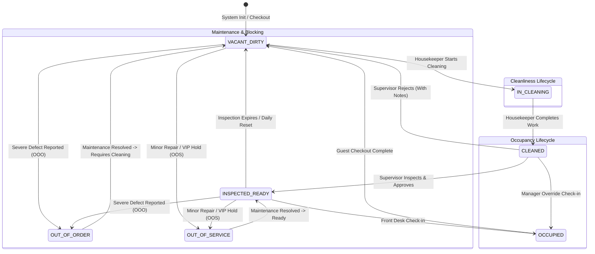

# 04-PROPERTY-ROOMS-RATES-AND-AVAILABILITY.md
# TapMenu HMS — Property Configuration, Room Inventory, Rate Engine & Real-Time Availability Architecture

---

## 1. Document Control & Metadata
- **Document Identifier:** `DOC-HMS-004`
- **System Name:** TapMenu HMS
- **Version:** 2.0.0
- **Document Status:** Implementation-Ready Engineering Specification
- **Primary Source:** `TapMenu_HMS_Final_Client_Specification(1).docx` (Sections 1, 4, 7, 8, 17, 21)
- **Traceability Tag:** `FR-ROOM-*`, `FR-RATE-*`, `BR-INV-*`, `DB-ROOM-*`

---

## 2. Property Hierarchy & Organizational Data Model

`[SOURCE REQUIREMENT]` & `[ENGINEERING DECISION]`
TapMenu HMS models hotel assets through a rigorous multi-tenant relational hierarchy:

```
┌─────────────────────────────────────────────────────────┐
│ ORGANIZATIONS (Organization Master / Brand Entity)      │
│ e.g., "Dream Heavens Hospitality Group"                 │
└────────────────────────────┬────────────────────────────┘
                             │ 1:N
                             ▼
┌─────────────────────────────────────────────────────────┐
│ PROPERTIES (Individual Hotel / Resort Property)         │
│ e.g., "Dream Heavens Resort & Spa, Jaipur"              │
│ - Property GSTIN, State Code, Currency (INR), Timezone  │
└──────────────┬───────────────────────────┬──────────────┘
               │ 1:N                       │ 1:N
               ▼                           ▼
┌────────────────────────────┐ ┌───────────────────────────┐
│ FLOORS & WINGS             │ │ ROOM TYPES                │
│ e.g., Ground Floor, Wing A │ │ e.g., Deluxe King, Suite  │
└──────────────┬─────────────┘ └───────────┬───────────────┘
               │                           │
               └─────────────┬─────────────┘
                             │ N:1 (Each room has 1 type & 1 floor)
                             ▼
               ┌───────────────────────────┐
               │ PHYSICAL ROOMS            │
               │ e.g., Room 101, Room 204  │
               │ - Cleanliness State       │
               │ - Maintenance State       │
               │ - Operational Status      │
               └───────────────────────────┘
```

### 2.1 Property Operating Configuration & Settings
Every property record maintains a 1:1 `property_settings` relation specifying critical operational invariants:
- `standard_checkin_time`: e.g., `14:00:00` `[CLIENT DECISION REQUIRED]`
- `standard_checkout_time`: e.g., `11:00:00` `[CLIENT DECISION REQUIRED]`
- `current_business_date`: Authoritative hotel calendar date advanced solely by Night Audit.
- `allow_overbooking`: Boolean (`FALSE` by default). `[SOURCE REQUIREMENT]`
- `max_overbooking_percentage`: Numeric allowance (e.g., `0.00%` default; up to `5.00%` if explicitly enabled).
- `default_tax_inclusive`: Boolean indicating whether published tariffs include GST.

---

## 3. Room Inventory & Physical Asset Structure

### 3.1 Room Types vs. Physical Rooms
1. **Room Type (`room_types`):**
   - Commercial selling unit (e.g., "Executive Suite").
   - Capacities: `base_adults` (e.g., 2), `max_adults` (e.g., 3), `max_children` (e.g., 2), `max_occupancy` (e.g., 4).
   - Base physical dimensions (sq. ft.), bed configuration (1 King or 2 Twin), and default room amenities (Wi-Fi, Balcony, Bathtub).
2. **Physical Room (`rooms`):**
   - Discrete physical asset (e.g., "Room 204").
   - Linked to a specific `floor_id` and `room_type_id`.
   - Dual-state tracking: Housekeeping Cleanliness State + Front Desk Occupancy State.

---

## 4. Authoritative Room State Machine

`[SOURCE REQUIREMENT]`
A physical room exists at the intersection of two distinct state vectors: **Cleanliness/Maintenance State** and **Occupancy State**. The state machine governs all operational transitions:



### 4.1 Valid State Definitions & Rules

| State Code | Operational Label | Sellable in Inventory? | Eligible for Check-in? | Affects Hotel Capacity? | Description & Transition Rule |
| :--- | :--- | :--- | :--- | :--- | :--- |
| `VACANT_DIRTY` | Dirty | Yes (for future dates) | **NO** | Yes (in capacity) | Room recently vacated or daily reset. Requires cleaning task. |
| `IN_CLEANING` | In Cleaning | Yes (for future dates) | **NO** | Yes (in capacity) | Housekeeper actively working in the room. |
| `CLEANED` | Cleaned | Yes (for future dates) | **NO** (Override only) | Yes (in capacity) | Cleaning completed by staff; pending supervisor inspection. |
| `INSPECTED_READY` | Ready / Inspected | **YES** | **YES** | Yes (in capacity) | Room verified by supervisor; ready for immediate guest check-in. |
| `OCCUPIED` | Occupied | **NO** (Occupied) | **NO** | Yes (in capacity) | Guest actively residing in room under active stay record. |
| `OUT_OF_ORDER` (OOO) | Out of Order | **NO** (Deducted) | **NO** | **NO (Deducted)** | Room offline due to physical/mechanical failure (e.g., burst pipe). Deducted from total hotel room capacity. |
| `OUT_OF_SERVICE` (OOS)| Out of Service | **NO** (Held) | **NO** | Yes (in capacity) | Room offline for minor painting, aesthetic repair, or VIP holding. Capacity metric unchanged. |

---

## 5. Rate Management Engine

`[SOURCE REQUIREMENT]`
The Rate Engine evaluates real-time tariffs across dynamic dimensions: room type, rate plan, calendar season, guest occupancy counts, and distribution channel.

```
┌─────────────────────────────────────────────────────────┐
│ RATE PLANS (e.g., EP - Room Only, CP - Bed & Breakfast) │
│ - Inclusions (Breakfast, Airport Shuttle, Wi-Fi)        │
│ - Cancellation Policy ID, Deposit Policy ID             │
│ - Market Segment: Direct Web, Walk-in, Corporate, OTA   │
└────────────────────────────┬────────────────────────────┘
                             │ 1:N
                             ▼
┌─────────────────────────────────────────────────────────┐
│ DAILY ROOM RATES (room_rates)                           │
│ - Property ID, Room Type ID, Rate Plan ID, Calendar Date│
│ - Base Rate (for Base Adult Occupancy, e.g., 2 Adults)  │
│ - Extra Adult Surcharge (e.g., +₹1,000/night)           │
│ - Extra Child Surcharge (e.g., +₹500/night)             │
│ - Extra Bed / Cot Surcharge                             │
└────────────────────────────┬────────────────────────────┘
                             │ 1:N
                             ▼
┌─────────────────────────────────────────────────────────┐
│ RATE RESTRICTIONS (rate_restrictions)                   │
│ - Min Length of Stay (Min LOS) / Max Length of Stay     │
│ - Closed to Arrival (CTA) / Closed to Departure (CTD)   │
│ - Stop Sell (Channel specific or global)                │
└─────────────────────────────────────────────────────────┘
```

### 5.1 Rate Calculation Algorithm (Integer Minor Units)
`[ENGINEERING DECISION]`
All monetary rates are evaluated in integer paise (1 INR = 100 paise). Floating-point calculation is strictly prohibited.

$$\text{Daily Tariff} = \text{BaseRate}_{\text{date}} + (N_{\text{adult}} - N_{\text{base}}) \times \text{ExtraAdultRate} + N_{\text{child}} \times \text{ExtraChildRate} + N_{\text{bed}} \times \text{ExtraBedRate}$$

#### Rate Plan Types Supported:
1. **Standard / Retail Rate (BAR - Best Available Rate):** Standard dynamic rate for public bookings.
2. **Corporate Negotiated Rates:** Bound to vetted corporate accounts (`companies` table) with agreed static or discounted tariffs.
3. **Travel Agent Rates:** Commissionable or net rate tiers with designated agent codes.
4. **Promotional & Package Rates:** Bundle room tariff with dining credits, spa sessions, or sightseeing.

---

## 6. Real-Time Availability Engine & Authoritative Concurrency Control

### 6.1 Formal Materialized Entity: `daily_inventory`
`[ENGINEERING DECISION]`
To ensure deterministic, ultra-fast availability lookups and rock-solid ACID concurrency protection, TapMenu HMS implements **Option A: Materialized Daily Inventory** stored in PostgreSQL.

Every property pre-populates `daily_inventory` for rolling 365 calendar days per room type:

```
Table: daily_inventory
--------------------------------------------------------------------------------------
Column Name           Type          Constraints / Notes
--------------------------------------------------------------------------------------
inventory_id          UUID          PRIMARY KEY DEFAULT gen_random_uuid()
property_id           UUID          NOT NULL REFERENCES properties(property_id) ON DELETE CASCADE
room_type_id          UUID          NOT NULL REFERENCES room_types(room_type_id) ON DELETE CASCADE
business_date         DATE          NOT NULL
total_rooms           INT           NOT NULL (Total physical rooms belonging to this type)
ooo_rooms             INT           NOT NULL DEFAULT 0 (Rooms in OUT_OF_ORDER state)
oos_rooms             INT           NOT NULL DEFAULT 0 (Rooms in OUT_OF_SERVICE state)
reserved_rooms        INT           NOT NULL DEFAULT 0 (Confirmed but not yet checked-in stays)
occupied_rooms        INT           NOT NULL DEFAULT 0 (Active checked-in stays)
held_rooms            INT           NOT NULL DEFAULT 0 (Temporary active 15-min booking holds)
available_rooms       INT           NOT NULL (Calculated sellable rooms remaining)
version_id            INT           NOT NULL DEFAULT 1 (Optimistic concurrency counter)
--------------------------------------------------------------------------------------
Constraints:
- UNIQUE (property_id, room_type_id, business_date)
- CHECK (total_rooms >= 0)
- CHECK (available_rooms >= 0 OR is_overbooked_allowed IS TRUE)
- CHECK (available_rooms = total_rooms - ooo_rooms - oos_rooms - reserved_rooms - occupied_rooms - held_rooms)
```

### 6.2 Authoritative Concurrency Lock (PostgreSQL `SELECT ... FOR UPDATE`)
`[CRITICAL ENGINEERING REQUIREMENT]`
Reservation correctness, inventory decrementing, and race protection rely **authoritatively and exclusively on PostgreSQL row-level locks**. 

Redis is strictly an optional read-cache and notification coordination mechanism. **If Redis is down or experiencing network partitions, the reservation engine remains 100% operational, fully atomic, and immune to double bookings.**

```mermaid
sequenceDiagram
    autonumber
    actor UserA as Guest on Website
    actor UserB as Front Desk Agent
    participant DB as PostgreSQL Transaction Engine (Sole Authority)

    Note over UserA,UserB: Exactly 1 Deluxe King Room Available for 15-Oct (available_rooms = 1)
    
    UserA->>DB: BEGIN TRANSACTION (Isolation Level: READ COMMITTED)
    UserB->>DB: BEGIN TRANSACTION (Isolation Level: READ COMMITTED)
    
    UserA->>DB: SELECT available_rooms FROM daily_inventory WHERE property_id=:p AND room_type_id=:rt AND business_date='2026-10-15' FOR UPDATE
    Note over DB: PostgreSQL grants exclusive row lock to Transaction A
    
    UserB->>DB: SELECT available_rooms FROM daily_inventory WHERE property_id=:p AND room_type_id=:rt AND business_date='2026-10-15' FOR UPDATE
    Note over DB: Transaction B blocks waiting for Transaction A lock release

    Note over UserA,DB: User A Validation & Mutex Execution
    UserA->>DB: Check: available_rooms (1) >= requested (1) -> PASSED
    UserA->>DB: UPDATE daily_inventory SET reserved_rooms = reserved_rooms + 1, available_rooms = available_rooms - 1 WHERE business_date='2026-10-15'
    Note over DB: available_rooms is now 0
    UserA->>DB: INSERT INTO reservations (status='CONFIRMED', ...)
    UserA->>DB: INSERT INTO reservation_rooms (...)
    UserA->>DB: COMMIT TRANSACTION
    Note over DB: Row lock released; Transaction A commits successfully

    Note over UserB,DB: Transaction B Unblocks & Inspects Committed State
    DB-->>UserB: Returns row: available_rooms = 0
    UserB->>DB: Check: available_rooms (0) >= requested (1) -> FAILED
    UserB->>DB: ROLLBACK TRANSACTION
    UserB-->>UserB: Raise RoomNotAvailableException -> 409 Conflict ("Room Sold Out")
```

### 6.3 Overbooking Management Policy
`[SOURCE REQUIREMENT]`
- Overbooking is disabled by default (`allow_overbooking = FALSE`).
- If an enterprise property explicitly enables overbooking, the system allows negative available counts strictly up to `max_overbooking_percentage` configured in `property_settings`.
- Any reservation confirmed within the overbooked threshold is flagged with `is_overbooked = TRUE` and immediately raises a priority warning badge on the Operations Dashboard to prompt manager allocation.
