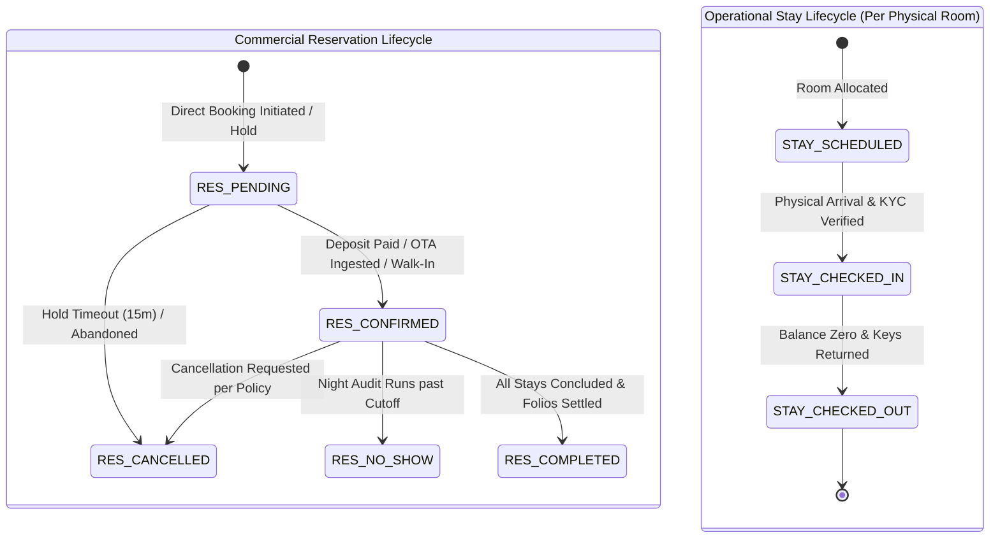
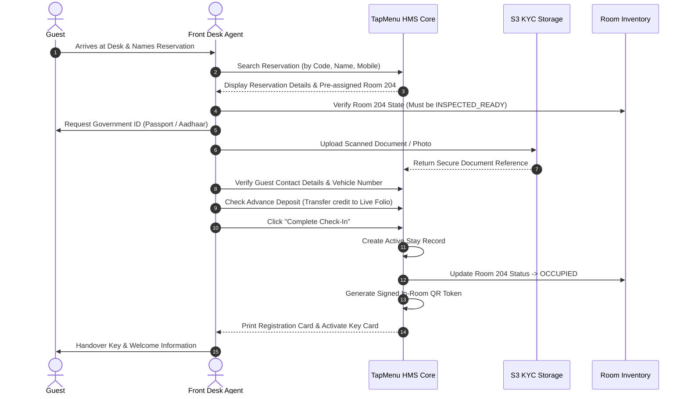

# 05-RESERVATIONS-FRONT-DESK-AND-GUESTS.md
# TapMenu HMS — Reservations Engine, Front Desk Operations & Guest 360 Architecture

---

## 1. Document Control & Metadata
- **Document Identifier:** `DOC-HMS-005`
- **System Name:** TapMenu HMS
- **Version:** 2.0.0
- **Document Status:** Implementation-Ready Functional Specification
- **Primary Source:** `TapMenu_HMS_Final_Client_Specification(1).docx` (Sections 3, 6, 7, 9, 23)
- **Traceability Tag:** `FR-RES-*`, `FR-FD-*`, `FR-GUEST-*`, `BR-RES-*`, `BR-FD-*`

---

## 2. Reservation Lifecycle & Stay Lifecycle

`[SOURCE REQUIREMENT]` & `[ENGINEERING DECISION]`
To properly support multi-room bookings and prevent operational confusion between commercial agreements and physical occupancy, TapMenu HMS explicitly separates **Commercial Reservation Status** from **Operational Stay Status**:

```
RESERVATION (Commercial Agreement)
├── PENDING       (Booking initiated; temporary 15-min hold)
├── CONFIRMED     (Guaranteed booking; deposit/allotment secured)
├── CANCELLED     (Booking voided per cancellation policy)
├── NO_SHOW       (Guest failed to arrive by cutoff hour)
└── COMPLETED     (All associated stays checked out and folios settled)

STAY (Physical Occupancy per Room)
├── SCHEDULED     (Room allocated/reserved, awaiting guest arrival)
├── CHECKED_IN    (Guest physically in room; key issued; folio active)
└── CHECKED_OUT   (Guest departed; folio settled; room set to DIRTY)
```



### 2.1 Formal State Definitions & Invariants

| Scope | State Code | Operational & Commercial Meaning | Inventory Impact (`daily_inventory`) |
| :--- | :--- | :--- | :--- |
| **Reservation** | `PENDING` | Temporary booking hold created via website or agent; awaiting deposit. | `held_rooms` incremented (auto-released after 15 mins). |
| **Reservation** | `CONFIRMED` | Guaranteed booking. Advance deposit held or corporate guarantee attached. | `reserved_rooms` incremented; `available_rooms` decremented. |
| **Reservation** | `CANCELLED` | Commercial booking annulled prior to check-in. | `reserved_rooms` decremented; `available_rooms` restored. |
| **Reservation** | `NO_SHOW` | Booker failed to arrive on scheduled date without notice. | Inventory released for remaining dates; penalty tariff charged. |
| **Reservation** | `COMPLETED` | All rooms under this booking have completed checkout and settled folios. | Historical record; zero active inventory hold. |
| **Stay** | `SCHEDULED` | Assigned physical room mapped to an upcoming arrival. | Pre-checkin room allocation. |
| **Stay** | `CHECKED_IN` | Guest physically registered in room; in-room QR token activated. | Room state = `OCCUPIED`; `occupied_rooms` incremented in daily inventory. |
| **Stay** | `CHECKED_OUT`| Guest concluded stay; keys returned; room flipped to `DIRTY`. | Room state = `VACANT_DIRTY`; `occupied_rooms` decremented. |

---

## 3. Reservation Management Capabilities

### 3.1 Multi-Source Ingestion
The system ingests reservations from six primary channels into a standardized schema:
1. **Direct Website (`SOURCE_WEBSITE`):** Ingested via public REST API with online payment gateway pre-authorization or deposit.
2. **Front Desk Direct / Walk-In (`SOURCE_WALK_IN`):** Instant booking and simultaneous check-in executed at the desk.
3. **Phone / Central Reservation Desk (`SOURCE_PHONE`):** Manual booking entry by reservation agents with payment link generation.
4. **Online Travel Agencies (`SOURCE_OTA`):** Push-ingested via Channel Manager adapters (Booking.com, Agoda, MakeMyTrip).
5. **Corporate Contracts (`SOURCE_CORPORATE`):** Bound to vetted company billing accounts with pre-negotiated contracted rates.
6. **Travel Agents (`SOURCE_TRAVEL_AGENT`):** Tagged with agent identification for commission reporting or gross/net billing.

### 3.2 Modification & Operational Scenarios
- **Date Changes:** Adjusting arrival/departure recalculates total stay tariff based on daily rate matrices for the new dates; validates continuous inventory availability.
- **Room Type Upgrade / Downgrade:** Rate delta calculated automatically. Upgrades can be flagged as "Complimentary Manager Upgrade" (requiring audit reason) or "Paid Upgrade".
- **Physical Room Move (During Stay):**
  1. Front desk initiates room move from Room 102 to Room 204.
  2. System verifies Room 204 is in `INSPECTED_READY` state.
  3. System updates stay record; generates housekeeping task for Room 102 (`DIRTY`); activates in-room QR token for Room 204.
  4. Master folio remains continuous and unchanged.

---

## 4. Front Desk Operations

### 4.1 Arrivals, Departures & In-House Management
The Front Desk console provides three dedicated real-time operational views:
1. **Expected Arrivals Dashboard:**
   - Filters: Today's arrivals, VIP arrivals, unassigned rooms, pending deposit balances.
   - 1-Click Action: "Assign Room", "Collect Deposit", "Express Check-In".
2. **In-House Stays Dashboard:**
   - Real-time list of all occupied rooms.
   - Monitors: Credit limit threshold alerts, active service requests, anticipated departure dates.
3. **Expected Departures Dashboard:**
   - Highlights rooms departing today, unbilled charges, outstanding balances, and late checkouts.

### 4.2 Check-In Workflow (Step-by-Step)


### 4.3 Checkout Workflow & Validation
`[CRITICAL BUSINESS RULE]`
Checkout cannot be finalized if `master_folio.balance != 0`.

1. **Balance Review:** Front desk reviews all line items with guest (room tariff, F&B, laundry, minibar).
2. **Settlement:** Outstanding balance settled via cash, credit card, UPI, or corporate Bill-to-Company.
3. **Invoice Sealing:** System generates sequential GST Tax Invoice (PDF generated asynchronously and emailed/printed).
4. **Checkout Execution:**
   - Stay status transitions to `CHECKED_OUT`.
   - Key card access invalidated; in-room QR token revoked.
   - Physical room status transitions immediately to `VACANT_DIRTY`.
   - High-priority turnover cleaning task dispatched to Housekeeping mobile board.

---

## 5. Group Reservations & Allotments

`[SOURCE REQUIREMENT]` (Calendar Group Booking Support) & `[ENGINEERING DECISION]`
- **Scope Status:** Core Group Booking is **MVP**; Advanced Cut-off Automation is **Phase 2**.
- **Group Master:** Groups link multiple rooms under an `Organizer` profile with a shared `group_code` (e.g., "WEDDING-KAPOOR-2026").
- **Rooming List:** Batch upload/entry of individual guest names mapped to specific blocked rooms.
- **Group Billing Flexibility:**
  - Option A: Master Folio absorbs all room charges (billed to organizer); guests pay personal incidentals.
  - Option B: Each room settles its own tariff and incidentals independently.

---

## 6. Guest 360° Profile & CRM Architecture

### 6.1 Unified Guest Profile Structure
The `guest_profiles` entity serves as the persistent identity record across all stays and properties:

```
┌─────────────────────────────────────────────────────────┐
│ GUEST PROFILE (Persistent Identity)                     │
│ - Unique Guest ID (UUID)                                │
│ - Full Name, Primary Mobile, Email, Nationality         │
│ - Identification (Aadhaar / Passport / DL Number)       │
│ - VIP Status: Standard, Silver, Gold, Platinum, VIP     │
│ - Total Historical Stays, Lifetime Net Revenue (Paise)  │
└──────────────┬───────────────────────────┬──────────────┘
               │ 1:N                       │ 1:N
               ▼                           ▼
┌────────────────────────────┐ ┌───────────────────────────┐
│ GUEST PREFERENCES          │ │ GUEST DOCUMENTS (KYC)     │
│ - Dietary: Vegan, Diabetic │ │ - S3 Private Object Key   │
│ - Room: High Floor, Quiet  │ │ - Document Type, Expiry   │
│ - Newspaper, Pillow Type   │ │ - Verification Status     │
└────────────────────────────┘ └───────────────────────────┘
```

### 6.2 Duplicate Detection & Guest Merge Engine
`[ENGINEERING DECISION]`
To prevent profile fragmentation:
1. **Detection Heuristic:** Incoming bookings automatically match against existing profiles using:
   - Primary: Exact match on `mobile_number` AND normalized `last_name`.
   - Secondary: Exact match on `email` OR `government_id_number`.
2. **Profile Merging:**
   - If staff identifies duplicate profiles, an authorized user executes `POST /api/v1/guests/{id}/merge`.
   - All historical stays, folios, notes, and preference records are reparented to the primary profile.
   - The secondary profile is archived with a pointer `merged_into_id`.
   - Full merge action recorded in the immutable audit log.

### 6.3 Strict Guest KYC Document Privacy Architecture
`[ENGINEERING DECISION]` & `[LEGAL/COMPLIANCE VALIDATION REQUIRED]`
Guest identification files (Aadhaar cards, passports, driving licenses) are governed by strict data protection invariants:

1. **Storage Topology:**
   - Files are stored in a dedicated, private S3-compatible bucket (`hms-guest-documents`).
   - Server-side encryption enabled at rest (SSE-KMS or AES-256).
   - **Zero Public Access:** S3 bucket has public access block completely enabled. No public URL exists.
2. **Access Control Flow:**
   - Direct database queries return only document metadata (`document_id`, `document_type`, `uploaded_at`), never raw storage URLs.
   - To view a document, an authorized staff member (e.g. Front Desk with `guest:view_documents` permission) must invoke `GET /api/v1/guests/{id}/documents/{doc_id}/download-url`.
   - Backend validates the user's role and property scope, generates a temporary HMAC-SHA256 signed presigned URL with an exact **15-minute Time-To-Live (TTL)**, and records an access event in `audit_logs`.
   - Any unauthenticated or unauthorized attempt to retrieve the document is denied with `401 Unauthorized` or `403 Forbidden`.
