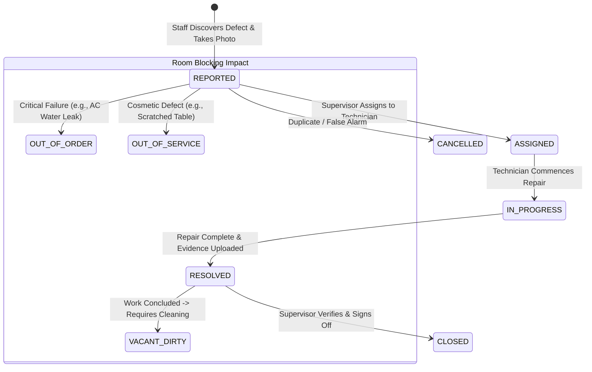
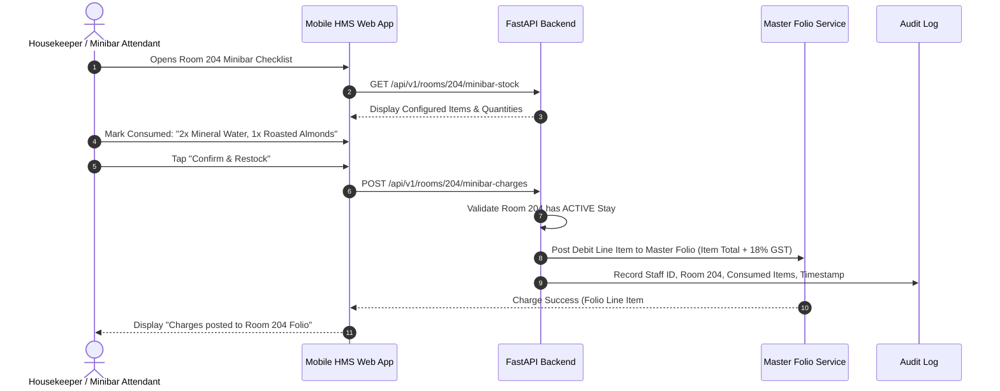

# 06-HOUSEKEEPING-MAINTENANCE-AND-OPERATIONS.md
# TapMenu HMS — Housekeeping, Maintenance, Operations, Linen & Asset Management

---

## 1. Document Control & Metadata
- **Document Identifier:** `DOC-HMS-006`
- **System Name:** TapMenu HMS
- **Version:** 2.0.0
- **Document Status:** Implementation-Ready Functional Specification
- **Primary Source:** `TapMenu_HMS_Final_Client_Specification(1).docx` (Sections 3, 4, 8)
- **Traceability Tag:** `FR-HK-*`, `FR-MAINT-*`, `BR-HK-*`, `DB-OPS-*`

---

## 2. Housekeeping Operations Architecture

### 2.1 Cleaning Task Taxonomy & Prioritization
`[SOURCE REQUIREMENT]`
Housekeeping tasks are systematically generated and prioritized based on operational hotel events:

| Task Type Code | Trigger Event | Priority Weight | Target SLA | Operational Description |
| :--- | :--- | :--- | :--- | :--- |
| `TASK_CHECKOUT_CLEAN` | Guest Checkout Completed | **HIGH (1)** | 45 Minutes | Complete linen strip, bathroom sanitization, floor scrub, restock amenities, minibar audit. Critical for room turnover. |
| `TASK_STAYOVER_CLEAN` | Daily Morning Batch (Night Audit) | **MEDIUM (2)** | 25 Minutes | Daily bed making, towel replacement, trash disposal, surface wipe for active in-house guests. |
| `TASK_DEEP_CLEAN` | Periodic Schedule / Long Stay Vacate | **LOW (3)** | 120 Minutes | Detailed carpet shampooing, curtain steaming, AC vent filtration, mattress rotation. |
| `TASK_TOUCHUP_CLEAN` | Unoccupied Room Idle > 48 Hours | **MEDIUM (2)** | 15 Minutes | Dusting and odor check for inspected rooms awaiting VIP check-in. |

### 2.2 Mobile Housekeeping Workflow & Touch Interactions
The housekeeping UI is engineered as an offline-tolerant, touch-first mobile application designed for staff moving along hotel corridors:

```
┌─────────────────────────────────────────────────────────┐
│ HOUSEKEEPER MOBILE CARD VIEW                            │
│ ┌─────────────────────────────────────────────────────┐ │
│ │ ROOM 204  •  DELUXE KING  •  CHECKOUT CLEAN         │ │
│ │ Status: VACANT DIRTY  |  Priority: URGENT           │ │
│ │ ┌───────────────────┐     ┌───────────────────────┐ │ │
│ │ │ ▶ START CLEANING  │     │ ⚠ REPORT ISSUE / PHOTO│ │ │
│ │ └───────────────────┘     └───────────────────────┘ │ │
│ └─────────────────────────────────────────────────────┘ │
└─────────────────────────────────────────────────────────┘
```

#### Workflow Steps:
1. **Assignment:** Supervisor assigns a batch of rooms (e.g., Floor 2) to a specific housekeeper (`assigned_to_user_id`).
2. **Start Work:** Housekeeper taps "Start Cleaning". Room status changes from `DIRTY` to `IN_CLEANING`. Timestamp logged.
3. **Minibar Check:** Housekeeper enters consumed minibar items directly into mobile form (e.g., "1 Diet Coke, 1 Pringles"). System automatically posts charges to the active folio if room is occupied.
4. **Completion:** Housekeeper taps "Mark Cleaned". Room status updates to `CLEANED`.
5. **Supervisor Inspection:**
   - Supervisor inspects room against standard checklist.
   - **Pass:** Supervisor taps "Approve Inspection" -> Room status flips to `INSPECTED_READY` (immediately sellable and ready for front desk check-in).
   - **Fail:** Supervisor taps "Reject" and enters mandatory defect reason -> Room reverts to `DIRTY` with high-priority re-clean badge.

### 2.3 PWA Offline Mutation Protocol & Conflict Handling
`[ENGINEERING DECISION]`
To handle corridor dead zones, the mobile PWA queues state changes locally in IndexedDB. However, **the server never blindly replays offline state mutations**.

1. **Mutation Envelope Specification:**
   Every queued offline mutation payload must contain:
   ```json
   {
     "command_id": "c7a8b901-1234-4567-890a-bcdef0123456",
     "device_id": "dev-ipad-fl2-004",
     "user_id": "3fa85f64-5717-4562-b3fc-2c963f66afa6",
     "property_id": "e4b3b123-4567-4890-a123-567890abcdef",
     "created_at": "2026-10-10T09:14:22.100Z",
     "client_sequence": 14,
     "idempotency_key": "hk-clean-204-seq14",
     "target_entity": "rooms",
     "entity_id": "8fa85f64-5717-4562-b3fc-2c963f66afa6",
     "base_server_version": 4,
     "transition_requested": "MARK_CLEANED"
   }
   ```
2. **Deterministic Conflict Resolution Matrix:**
   When the device reconnects and submits the mutation queue:
   - **Case A (Clean Match):** Server `version_id == base_server_version` and current status is `IN_CLEANING`. Mutation succeeds; status becomes `CLEANED`; `version_id` increments to 5.
   - **Case B (Maintenance Collision):** While housekeeper was offline, Supervisor marked room `OUT_OF_ORDER` (server `version_id` became 5; status is `OUT_OF_ORDER`).
     - Server detects conflict: state transition `OUT_OF_ORDER -> CLEANED` is illegal per room state machine.
     - Server **rejects** mutation with `409 Conflict` (`ROOM_STATE_CONFLICT`).
     - Client logs conflict notice on device: "Room 204 was set to Out of Order by Maintenance Supervisor. Cleaning status not updated."
   - **Case C (Idempotent Duplicate):** Server sees `command_id` or `idempotency_key` already processed $\rightarrow$ returns stored success without re-executing.

## 3. Maintenance Engineering & Work Orders

### 3.1 Ticket Lifecycle & Defect Management
`[SOURCE REQUIREMENT]`
Maintenance tickets track physical property defects, equipment breakdowns, and routine servicing across hotel assets.



### 3.2 Maintenance Ticket Attributes

| Field Name | Type | Description & Operational Constraint |
| :--- | :--- | :--- |
| `ticket_id` | UUID | Primary key. |
| `property_id` | UUID | Tenant property boundary. |
| `room_id` | UUID (Nullable) | Linked physical room (null if public area / restaurant defect). |
| `category` | Enum | `PLUMBING`, `ELECTRICAL`, `HVAC`, `CARPENTRY`, `APPLIANCE`, `CIVIL`. |
| `priority` | Enum | `LOW`, `MEDIUM`, `HIGH`, `CRITICAL_EMERGENCY`. |
| `title` | Varchar(150) | Brief description (e.g., "Bathroom Geyser tripping circuit breaker"). |
| `photo_url` | Text | S3 presigned URL of defect photo captured via mobile camera. |
| `blocks_inventory` | Boolean | If `TRUE`, triggers room transition to `OUT_OF_ORDER` (OOO) or `OUT_OF_SERVICE` (OOS). |
| `downtime_minutes` | Integer | System-calculated duration from ticket creation to resolution. |

---

## 4. Linen & Laundry Tracking

`[SOURCE REQUIREMENT]`
Hotels process large volumes of bed sheets, duvet covers, pillowcases, and bath towels through in-house or external laundry vendors:

1. **Daily Linen Count:**
   - Housekeepers log soiled linen stripped from checkout and stayover rooms.
   - Central linen room records soiled stock aggregated per floor.
2. **Vendor Dispatch & Delivery Cycle:**
   - Soiled linen dispatched to external vendor with delivery challan (`dispatched_count`).
   - Clean linen returned by vendor, verified, and counted (`received_count`).
   - Discrepancy calculations: `Loss / Damage Count = dispatched_count - received_count`.
3. **Linen Asset Ledger:**
   - Monitors property-wide linen circulation ratio (standard 3-par stock: 1 set in room, 1 set on shelf, 1 set in laundry).

---

## 5. Minibar Management & Auto-Folio Posting

`[SOURCE REQUIREMENT]`
Minibar consumptions represent high-friction hotel operations that TapMenu HMS automates through mobile integration:



---

## 6. Lost & Found Registry

`[SOURCE REQUIREMENT]`
A centralized, auditable registry for items left behind by guests:

- **Logging:** Item Name, Category (Electronics, Jewelry, Clothing, Documents), Physical Room Number, Finder Staff Name, High-Resolution Photo (stored in S3), Date/Time found.
- **Custody Location:** Locked Housekeeping Locker Reference (e.g., "Locker B-3").
- **Resolution Status:**
  - `LOGGED`: Item in safe storage.
  - `CLAIMED`: Guest contacted, identity verified, handed over at front desk or dispatched via courier with tracking number.
  - `UNCLAIMED_DISPOSED`: Retained past property policy threshold (e.g., 90 days); auctioned or discarded per management policy.

---

## 7. Guest & Staff Service Requests

`[SOURCE REQUIREMENT]`
Operational service requests initiated either by guests (via In-Room QR web app) or front-desk staff on behalf of a guest:

- **Categories:** Extra Towels, Dental Kit, Bucket of Ice, Room Cleaning Request, Luggage Assistance, Iron & Board.
- **Dispatching:** Automatically routed to the active Housekeeping or Concierge queue.
- **SLA Escalation:** If a high-priority request is unacknowledged after 15 minutes, system emits a visual alert on the Front Desk dashboard.
