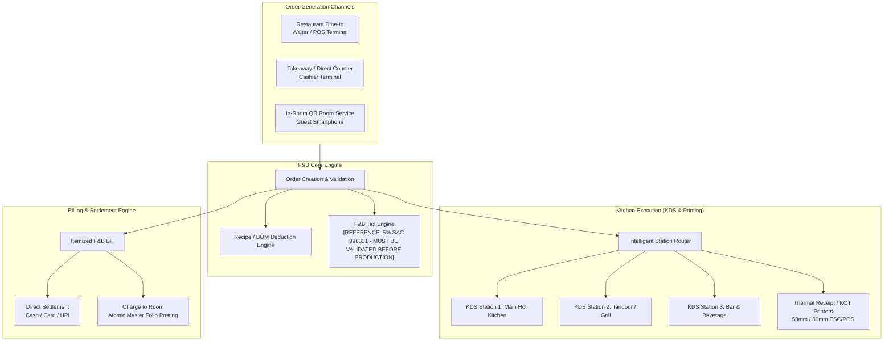
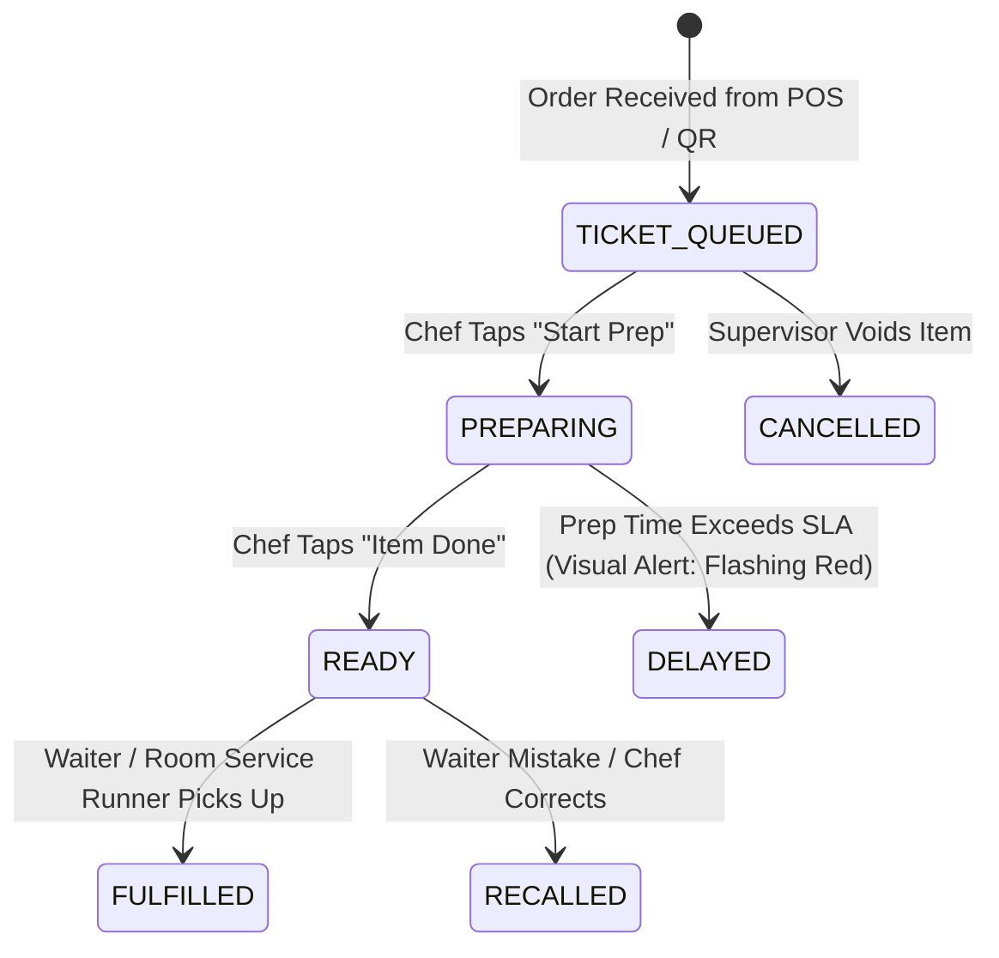
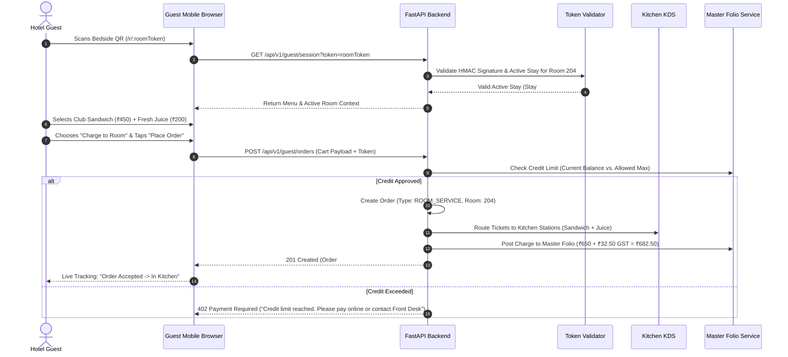

# 07-FNB-POS-KDS-ROOM-SERVICE.md
# TapMenu HMS — Food & Beverage (F&B), Restaurant POS, Kitchen Display System (KDS) & Room Service Architecture

---

## 1. Document Control & Metadata
- **Document Identifier:** `DOC-HMS-007`
- **System Name:** TapMenu HMS
- **Version:** 2.0.0
- **Document Status:** Implementation-Ready Engineering Specification
- **Primary Source:** `TapMenu_HMS_Final_Client_Specification(1).docx` (Sections 1, 3, 7, 10, 23)
- **Traceability Tag:** `FR-POS-*`, `FR-KDS-*`, `FR-RS-*`, `BR-POS-*`, `DB-FNB-*`

---

## 2. F&B Architecture & Unified Operations

`[SOURCE REQUIREMENT]`
In TapMenu HMS, Food & Beverage is engineered as a **first-class integrated operational module** rather than a disconnected external restaurant POS. 

- Single menu database and modifier structure across all outlets (Main Restaurant, Rooftop Lounge, Bar, Room Service).
- Unified Kitchen Display System (KDS) handling both table dine-in orders and guest room-service orders.
- Native, direct posting of dining bills to the Master Guest Folio without manual re-keying or paper voucher reconciliation.



---

## 3. Restaurant Point of Sale (POS) & Table Management

### 3.1 Table Floor Plan & Live Statuses
`[SOURCE REQUIREMENT]`
The POS interface presents a visual, drag-and-drop floor plan modeling physical restaurant layout:

```
┌─────────────────────────────────────────────────────────────────────────────┐
│ RESTAURANT FLOOR PLAN: MAIN DINING HALL (OUTLET ID: REST-01)               │
│                                                                             │
│   ┌───────────────┐     ┌───────────────┐     ┌───────────────┐             │
│   │ TABLE T1 (4p) │     │ TABLE T2 (2p) │     │ TABLE T3 (6p) │             │
│   │ [AVAILABLE]   │     │ [SEATED]      │     │ [ORDERED]     │             │
│   │ ₹0.00         │     │ 15 Mins Active│     │ KOT #104 (20m)│             │
│   └───────────────┘     └───────────────┘     └───────────────┘             │
│                                                                             │
│   ┌───────────────┐     ┌───────────────┐     ┌───────────────┐             │
│   │ TABLE T4 (4p) │     │ TABLE T5 (4p) │     │ TABLE T6 (2p) │             │
│   │ [BILLED]      │     │ [AVAILABLE]   │     │ [ORDERED]     │             │
│   │ ₹2,450 Due    │     │ ₹0.00         │     │ KOT #108 (5m) │             │
│   └───────────────┘     └───────────────┘     └───────────────┘             │
└─────────────────────────────────────────────────────────────────────────────┘
```

#### Table Status Lifecycle:
- `AVAILABLE` (Green): Table clean, unoccupied, ready for guests.
- `SEATED` (Blue): Guests seated; menu presented; no active order.
- `ORDERED` (Yellow): KOT sent to kitchen; items currently in preparation.
- `BILLED` (Red): Final bill printed; awaiting payment or room charge.

### 3.2 Menu Engineering, Categories & Modifiers
- **Categories:** Starters, Soups, Main Course, Tandoor, Breads, Desserts, Non-Alcoholic Beverages, Cocktails.
- **Menu Items (`menu_items`):**
  - Name, Description, Food Category, Dietary Flag (`VEG`, `NON_VEG`, `EGG`, `VEGAN`), Price (in integer paise), SAC/HSN Code (e.g., SAC `996331` `[REFERENCE CONFIGURATION — MUST BE VALIDATED BEFORE PRODUCTION]`), Active Status.
- **Modifiers & Add-ons (`menu_item_modifiers`):**
  - Mandatory Single-Select: E.g., Choice of Crust ("Thin Crust" vs. "Cheese Burst +₹100").
  - Optional Multi-Select: E.g., Extra Cheese (+₹50), Jalapeños (+₹30).
  - Preparation Cooking Notes: Free-text kitchen instructions (e.g., "Very spicy, less salt").

---

## 4. Kitchen Display System (KDS) & Order Routing

### 4.1 Station Routing Architecture
`[SOURCE REQUIREMENT]`
Orders placed at tables or via in-room QR are automatically split and routed to specific kitchen preparation stations based on category mapping:

```
[Incoming Order: 1x Butter Chicken, 2x Butter Naan, 1x Fresh Lime Soda]
                          │
          ┌───────────────┼───────────────┐
          ▼               ▼               ▼
   [MAIN KITCHEN]    [TANDOOR / BREAD]    [BAR / BEVERAGE]
   1x Butter Chicken   2x Butter Naan     1x Fresh Lime Soda
```

### 4.2 KDS Ticket State Machine & Touch Controls
Each station displays large, high-contrast cards touch-optimized for hot kitchen environments:



- **SLA Alerts:** Items exceeding target preparation time (e.g., > 20 minutes) dynamically flash red to prioritize cooking lines.
- **Hardware Printing Support:** Standard ESC/POS thermal printing for physical Kitchen Order Tickets (KOT) on 58mm or 80mm roll printers.

---

## 5. In-Room QR Room Service & Folio Posting

### 5.1 In-Room Dining Workflow
`[SOURCE REQUIREMENT]`
Guests scan a bedside QR code to order room service without downloading a native mobile app:



### 5.2 Charge-to-Room Validation Rules
`[CRITICAL BUSINESS RULE]`
A food & beverage charge can be posted to a guest room **only if all five conditions are satisfied**:
1. Physical room exists and has an `OCCUPIED` status.
2. An active, checked-in stay record is currently linked to that room.
3. Master folio status is `OPEN`.
4. Guest identity is confirmed (via signed digital room token for QR, or guest signature/name verification at restaurant POS).
5. Folio outstanding balance plus the new charge does not exceed the property's configured guest credit limit.

---

## 6. Recipe Management, Bill of Materials (BOM) & Inventory Deductions

`[SOURCE REQUIREMENT]` & `[PROPOSED]`
- **Scope Status:** Core POS & Billing is **MVP**; Automated BOM Stock Deduction is **Phase 2**.
- **Bill of Materials (BOM):** Each menu item links to raw ingredient quantities (e.g., 1 serving of Butter Chicken = 250g Chicken, 50g Butter, 100ml Cream, 150g Tomato Puree).
- **Automated Deduction:** Upon order completion, backend background tasks decrement raw ingredient inventory from the central kitchen stock ledger.
- **Low-Stock Alerts:** When ingredient inventory drops below the configured reorder point, an alert badge is surfaced on the Chef's dashboard to prevent ordering out-of-stock dishes.
