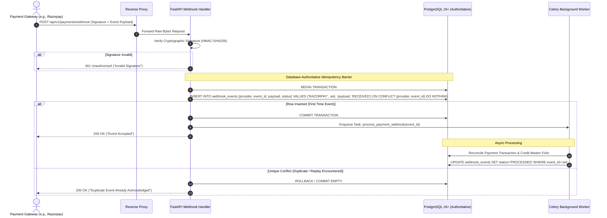
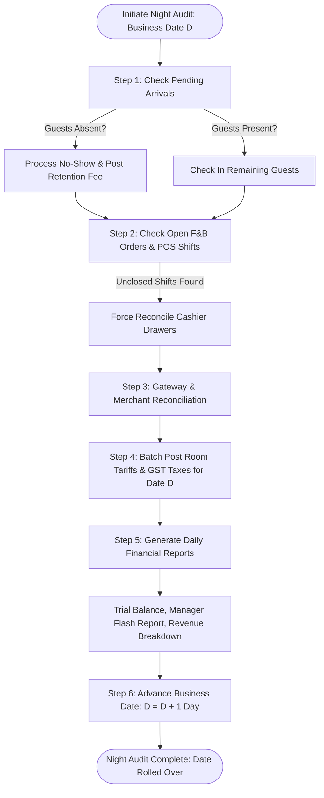

# 08-FOLIO-BILLING-PAYMENTS-AND-NIGHT-AUDIT.md
# TapMenu HMS — Master Guest Folio, Billing Engine, Indian GST, Payment Gateways & Night Audit Specification

---

## 1. Document Control & Metadata
- **Document Identifier:** `DOC-HMS-008`
- **System Name:** TapMenu HMS
- **Version:** 2.0.0
- **Document Status:** Implementation-Ready Financial & Accounting Specification
- **Primary Source:** `TapMenu_HMS_Final_Client_Specification(1).docx` (Sections 1, 3, 11, 12, 23)
- **Traceability Tag:** `FR-FOLIO-*`, `FR-PAY-*`, `FR-TAX-*`, `FR-AUDIT-*`, `BR-FOLIO-*`

---

## 2. Inviolable Financial Principles & Accounting Invariants

`[SOURCE REQUIREMENT]` & `[ENGINEERING DECISION]`
All financial subsystems in TapMenu HMS operate under strict, double-entry style accounting principles:

1. **Integer Minor Currency Units (Zero Floating Point):**
   - Every monetary figure (rates, charges, taxes, discounts, deposits, payments, refunds) is stored as a 64-bit integer (`BIGINT`) representing the smallest currency denomination (e.g., Paisa in INR: ₹1,450.50 is stored as integer `145050`).
   - Floating-point arithmetic (`FLOAT`, `DOUBLE`) is strictly prohibited to eradicate IEEE 754 precision drift.
2. **Absolute Immutability of Posted Financial Records:**
   - A posted folio line item or payment record **can never be deleted or modified in place** (`DELETE` and `UPDATE` on transaction amounts are blocked at both ORM and database trigger levels).
   - Corrections require compensatory **Adjustment / Allowance** entries or **Reversal** line items with mandatory operational reasons and manager approval.
3. **Mathematical Parity of the Folio:**
   $$\text{Folio Balance} = \sum (\text{Debits}) - \sum (\text{Credits})$$
   Where:
   - $\text{Debits}$: Room tariffs, F&B orders, laundry, minibar, ancillary charges, debit adjustments, applicable taxes.
   - $\text{Credits}$: Advance deposits, mid-stay payments, final checkout settlements, promotional discounts, credit allowances.

---

## 3. Master Guest Folio Architecture

`[SOURCE REQUIREMENT]`
The Master Folio is the single operational financial ledger aggregating all departmental hotel services:

```
ROOM TARIFF ────────┐
RESTAURANT ─────────┤
ROOM SERVICE (QR) ──┤
LAUNDRY ────────────┤
MINIBAR ────────────┼──► MASTER FOLIO (Live Working Ledger)
AIRPORT TRANSFER ───┤          │
SPA / ANCILLARY ────┘          ├──► SPLIT SUB-FOLIOS (Corp Tariff vs. Incidentals)
                               │
                               ▼
                        PAYMENTS & SETTLEMENTS (Cash, Card, UPI, Bill-to-Company)
                               │
                               ▼
                        SEQUENTIAL GST TAX INVOICE & RECEIPT
```

### 3.1 Illustrative Folio Ledger Calculation

| Line # | Date / Time | Department | SAC / HSN | Description | Debits (Paise) | Credits (Paise) | Running Balance |
| :---: | :--- | :--- | :--- | :--- | :---: | :---: | :---: |
| 1 | 10-Oct 14:00 | Front Desk | — | Advance Deposit (UPI / Razorpay) | — | 700,000 | -₹7,000.00 |
| 2 | 10-Oct 21:00 | Room Service | 996331 | KOT #1042 (Club Sandwich, Juice) + 5% GST | 68,250 | — | -₹6,317.50 |
| 3 | 11-Oct 02:00 | Night Audit | 9963 | Room Tariff Night 1 + 12% GST | 728,000 | — | +₹962.50 |
| 4 | 11-Oct 13:30 | Restaurant | 996331 | Table T3 Dining Bill + 5% GST | 231,000 | — | +₹3,272.50 |
| 5 | 11-Oct 17:00 | Front Desk | — | Mid-Stay Interim Payment (Credit Card) | — | 500,000 | -₹1,727.50 |
| 6 | 11-Oct 19:00 | Laundry | 998365 | Laundry Service (Dry Clean) + 18% GST | 141,600 | — | -₹311.50 |
| 7 | 12-Oct 02:00 | Night Audit | 9963 | Room Tariff Night 2 + 12% GST | 728,000 | — | +₹6,968.50 |
| 8 | 12-Oct 10:00 | Minibar | 2202 | Minibar Consumption + 18% GST | 53,100 | — | +₹7,499.50 |
| 9 | 12-Oct 11:00 | Front Desk | — | Final Checkout Settlement (UPI) | — | 749,950 | **₹0.00** |

### 3.2 Split Folio Operations (Corporate vs. Incidentals)
`[SOURCE REQUIREMENT]`
In corporate travel, room tariffs are frequently billed to an enterprise account while personal dining and minibar are settled by the guest:
1. **Parent-Child Ledger:** The stay creates `Folio A` (Corporate Bill-to-Company) and `Folio B` (Guest Incidentals).
2. **Automated Rule Routing:** System automatically routes line items:
   - Tariff + Room GST $\rightarrow$ `Folio A`.
   - In-Room Dining, Restaurant, Minibar, Laundry $\rightarrow$ `Folio B`.
3. **Settlement Independence:** `Folio B` settled in full by guest at desk; `Folio A` transferred to the Corporate City Ledger (Accounts Receivable).

---

## 4. Indian GST Hospitality Tax Engine

`[SOURCE REQUIREMENT]` & `[LEGAL/COMPLIANCE VALIDATION REQUIRED]`
The tax engine implements dynamically configurable Indian Goods and Services Tax (GST) rules based on Service Accounting Codes (SAC), declared tariff slabs, and jurisdictional state code logic.

> [!IMPORTANT]
> Tax slabs, SAC codes, and rates are **never permanently hardcoded in application logic**. They reside in the configurable `tax_rules` table and must be formally validated against the hotel's current tax registration and applicable statutory law before production deployment.

### 4.1 Configurable Tax Rule Schema
`[ENGINEERING DECISION]`
Every tax computation references an active rule entity defined as follows:

```
Entity: Tax Rule (tax_rules)
├── rule_id (UUID)
├── property_id (UUID)
├── service_category (ACCOMMODATION | RESTAURANT_DINE_IN | ROOM_SERVICE_FNB | LAUNDRY | TRANSPORT | SPA)
├── sac_hsn_code (e.g., "9963", "996331", "998365", "9964")
├── effective_from (DATE)
├── effective_to (DATE NULL)
├── tax_rate_basis_type (SLAB_TIERED_BY_DECLARED_TARIFF | FLAT_PERCENTAGE)
├── slab_min_minor (BIGINT NULL - e.g., 0 paise)
├── slab_max_minor (BIGINT NULL - e.g., 750000 paise)
├── total_tax_rate_pct (NUMERIC - e.g., 12.00%)
├── cgst_rate_pct (NUMERIC - e.g., 6.00%)
├── sgst_rate_pct (NUMERIC - e.g., 6.00%)
├── igst_rate_pct (NUMERIC - e.g., 12.00%)
├── applicability_conditions (JSONB)
└── legal_validation_status (PENDING_LEGAL_VALIDATION | VALIDATED_COMPLIANT)
```

### 4.2 Reference Hospitality Tax Slabs
`[REFERENCE CONFIGURATION — MUST BE VALIDATED BEFORE PRODUCTION]`
The following table represents the baseline reference configuration derived from current hospitality practice, subject to client legal confirmation:

| Service Category | SAC / HSN Code | Reference Tax Rule Condition | CGST Rate | SGST Rate | IGST (Inter-State) | Reference Legal Status |
| :--- | :---: | :--- | :---: | :---: | :---: | :--- |
| **Hotel Accommodation** | SAC `9963` | Declared room tariff $\le$ ₹7,500/night (750,000 paise) | 6% | 6% | 12% | `[REFERENCE CONFIGURATION — MUST BE VALIDATED]` |
| **Hotel Accommodation** | SAC `9963` | Declared room tariff > ₹7,500/night (750,000 paise) | 9% | 9% | 18% | `[REFERENCE CONFIGURATION — MUST BE VALIDATED]` |
| **Restaurant / Room Service F&B** | SAC `996331` | Standalone dining / In-room food & beverage | 2.5% | 2.5% | 5% | `[REFERENCE CONFIGURATION — MUST BE VALIDATED]` |
| **Laundry Services** | SAC `998365` | In-house guest laundry and dry cleaning | 9% | 9% | 18% | `[REFERENCE CONFIGURATION — MUST BE VALIDATED]` |
| **Airport Transfer / Cab** | SAC `9964` | Transport / Passenger vehicle hire | 2.5% | 2.5% | 5% | `[REFERENCE CONFIGURATION — MUST BE VALIDATED]` |

### 4.3 Inter-State vs. Intra-State Tax Calculation Logic
$$\text{Is Intra-State} = (\text{Guest State Code} == \text{Property State Code}) \lor (\text{Guest GSTIN is NULL})$$

- If **Intra-State:** Tax is divided equally into **CGST** and **SGST** (e.g., 12% GST = 6% CGST + 6% SGST).
- If **Inter-State** (Guest provides registered out-of-state corporate GSTIN): Tax is billed entirely as **IGST** (e.g., 12% IGST).

### 4.4 Sequential Tax Invoice Numbering
- Every finalized folio generates a legal GST Tax Invoice with a strictly sequential, gapless numbering series per financial year per property (e.g., `INV/2026-27/00142`).
- Voided invoices maintain their number in the registry with a `VOIDED` watermark and cannot be reused or expunged.

---

## 5. Payments, Gateway Integration & Webhook Reconciliation

### 5.1 Supported Payment Methods
`[SOURCE REQUIREMENT]`
1. **Cash:** Recorded with shift cashier drawer tracking.
2. **Credit / Debit Cards:** Recorded via EDC POS terminal batch reference or direct gateway.
3. **UPI:** Dynamic or static QR collection with UTR / bank reference number.
4. **Online Payment Gateway:** Integrated Razorpay, Pine Labs, Paytm, or Stripe API.
5. **Bill to Company (BTC):** Charge transfer to approved corporate account.
6. **Advance Deposit Redemption:** Consuming pre-check-in booking advance.

### 5.2 Payment Webhook Processing & Database-Authoritative Idempotency
`[CRITICAL ENGINEERING REQUIREMENT]`
Webhook deduplication and replay safety rely on **PostgreSQL database unique constraints**, not solely in-memory Redis keys. Redis is used only as an optional acceleration cache; the database is the authoritative barrier:



---

## 6. Cashier Shift Management & The Night Audit Process

### 6.1 Shift Open & Close Sequence
1. **Shift Open:** Cashier starts shift by entering starting float amount (e.g., ₹5,000 cash drawer opening).
2. **Transactions:** System logs all physical cash receipts, card EDC slips, and manual refunds against active shift ID.
3. **Shift Close:** Cashier enters physical cash count. System calculates **Expected Cash vs. Actual Cash** variance. Discrepancies logged to manager review.

### 6.2 Night Audit Execution Workflow
`[SOURCE REQUIREMENT]`
Night Audit is the authoritative end-of-day operational checkpoint executed daily (typically at 02:00 AM) to balance financial books and advance the hotel business date:



---

## 7. Corporate Accounts & Accounts Receivable (City Ledger)

`[SOURCE REQUIREMENT]`
1. **Corporate Registry (`companies`):** Legal Business Name, Corporate GSTIN, Billing Address, Approved Credit Limit (in paise), Agreed Credit Terms (e.g., Net 30 Days).
2. **Bill to Company (BTC) Settlement:**
   - Front desk transfers approved folio balance to Corporate Account.
   - Master folio balance becomes zero; liability moves to City Ledger Accounts Receivable.
3. **Credit Limit Monitoring:** If a corporate account's total outstanding invoices reach or exceed `credit_limit`, the system blocks further BTC charge routing until outstanding invoices are settled.
