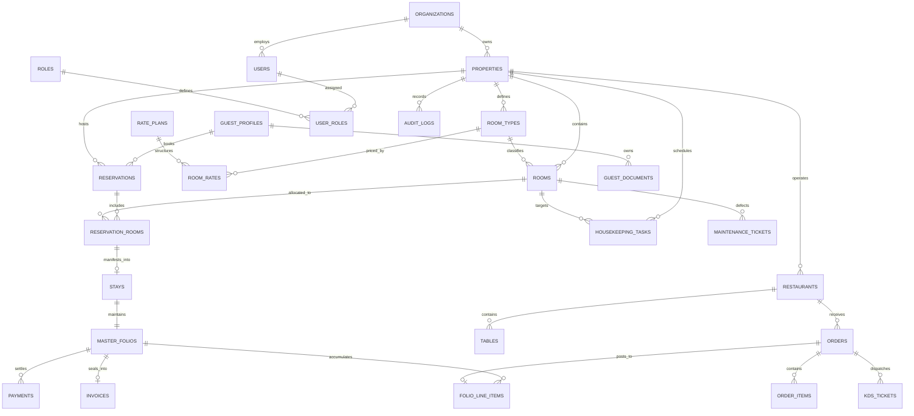

# 11-DATABASE-DATA-MODEL.md
# TapMenu HMS — Relational Database Architecture & Comprehensive Data Model

---

## 1. Document Control & Metadata
- **Document Identifier:** `DOC-HMS-011`
- **System Name:** TapMenu HMS
- **Version:** 2.0.0
- **Document Status:** Implementation-Ready Database Specification
- **Primary Source:** `TapMenu_HMS_Final_Client_Specification(1).docx` (Sections 12, 19, 21, Appendix A)
- **Target Engine:** PostgreSQL 16+
- **Traceability Tag:** `DB-SCHEMA-*`, `DB-TABLE-*`

---

## 2. Global Database Design Conventions

`[ENGINEERING DECISION]`
1. **Primary Keys:** RFC 4122 Type 4 UUIDs (`UUID DEFAULT gen_random_uuid()`) across all core entities to guarantee global uniqueness and safe multi-property distributed generation.
2. **Monetary Representation:** Stored strictly as 64-bit integers (`BIGINT`) representing minor currency units (e.g., Paise in INR). Zero floating-point types (`REAL`, `FLOAT`, `DOUBLE PRECISION`) permitted.
3. **Timestamps:** Stored strictly with timezone (`TIMESTAMPTZ`), normalized to UTC at storage level.
4. **Tenant Isolation:** Every operational table contains a non-nullable `property_id` foreign key referencing `properties(property_id)`, with B-tree index on `(property_id)`.
5. **Optimistic Locking:** Entities subject to concurrent edits (`reservations`, `rooms`, `master_folios`) include an integer `version_id INT DEFAULT 1` incremented on every update.
6. **Soft Deletion:** Business entities retain a `deleted_at TIMESTAMPTZ NULL` column where deletion must preserve historical integrity. Financial ledgers and audit records **never** support deletion of any kind.

---

## 3. High-Level Entity-Relationship (ER) Architecture

---

## 4. Comprehensive Entity Specifications

### 4.1 Module: Organization & Property Hierarchy

#### 4.1.1 `organizations`
- **Purpose:** Represents the top-level corporate brand or hospitality ownership group.
- **Fields:**
  - `org_id` UUID PRIMARY KEY DEFAULT gen_random_uuid()
  - `name` VARCHAR(150) NOT NULL
  - `legal_entity_name` VARCHAR(200) NOT NULL
  - `created_at` TIMESTAMPTZ NOT NULL DEFAULT clock_timestamp()
  - `is_active` BOOLEAN NOT NULL DEFAULT TRUE

#### 4.1.2 `properties`
- **Purpose:** Represents an individual hotel, resort, or branch.
- **Fields:**
  - `property_id` UUID PRIMARY KEY DEFAULT gen_random_uuid()
  - `org_id` UUID NOT NULL REFERENCES organizations(org_id) ON DELETE RESTRICT
  - `code` VARCHAR(20) NOT NULL UNIQUE (e.g., "DH-JPR")
  - `name` VARCHAR(150) NOT NULL
  - `address_line1` VARCHAR(255) NOT NULL
  - `city` VARCHAR(100) NOT NULL
  - `state_code` VARCHAR(2) NOT NULL (e.g., "08" for Rajasthan)
  - `postal_code` VARCHAR(20) NOT NULL
  - `country_code` VARCHAR(2) NOT NULL DEFAULT 'IN'
  - `gstin` VARCHAR(15) NULL (Indian 15-character GST identification number)
  - `currency` VARCHAR(3) NOT NULL DEFAULT 'INR'
  - `timezone` VARCHAR(50) NOT NULL DEFAULT 'Asia/Kolkata'
  - `created_at` TIMESTAMPTZ NOT NULL DEFAULT clock_timestamp()
- **Indexes:** `idx_properties_org (org_id)`, `idx_properties_code (code)`.

#### 4.1.3 `property_settings`
- **Purpose:** Key-value operational configuration and business date anchor.
- **Fields:**
  - `property_id` UUID PRIMARY KEY REFERENCES properties(property_id) ON DELETE CASCADE
  - `current_business_date` DATE NOT NULL
  - `standard_checkin_time` TIME NOT NULL DEFAULT '14:00:00'
  - `standard_checkout_time` TIME NOT NULL DEFAULT '11:00:00'
  - `allow_overbooking` BOOLEAN NOT NULL DEFAULT FALSE
  - `max_overbooking_pct` NUMERIC(4,2) NOT NULL DEFAULT 0.00
  - `default_tax_inclusive` BOOLEAN NOT NULL DEFAULT FALSE
  - `night_audit_status` VARCHAR(20) NOT NULL DEFAULT 'IDLE'

---

### 4.2 Module: Room Inventory, Housekeeping & Rates

#### 4.2.1 `room_types`
- **Purpose:** Commercial room categories.
- **Fields:**
  - `room_type_id` UUID PRIMARY KEY DEFAULT gen_random_uuid()
  - `property_id` UUID NOT NULL REFERENCES properties(property_id) ON DELETE CASCADE
  - `code` VARCHAR(30) NOT NULL (e.g., "DLX_KING")
  - `name` VARCHAR(100) NOT NULL
  - `base_adults` SMALLINT NOT NULL DEFAULT 2
  - `max_adults` SMALLINT NOT NULL DEFAULT 3
  - `max_children` SMALLINT NOT NULL DEFAULT 2
  - `max_occupancy` SMALLINT NOT NULL DEFAULT 4
  - `base_rate_minor` BIGINT NOT NULL (Base rate in paise)
  - `amenity_tags` JSONB NOT NULL DEFAULT '[]'
  - `is_active` BOOLEAN NOT NULL DEFAULT TRUE
- **Constraints:** UNIQUE (`property_id`, `code`), CHECK (`max_occupancy >= base_adults`).

#### 4.2.2 `rooms`
- **Purpose:** Physical rooms on property.
- **Fields:**
  - `room_id` UUID PRIMARY KEY DEFAULT gen_random_uuid()
  - `property_id` UUID NOT NULL REFERENCES properties(property_id) ON DELETE CASCADE
  - `room_type_id` UUID NOT NULL REFERENCES room_types(room_type_id) ON DELETE RESTRICT
  - `room_number` VARCHAR(20) NOT NULL (e.g., "204")
  - `floor_number` SMALLINT NOT NULL (e.g., 2)
  - `clean_status` VARCHAR(20) NOT NULL DEFAULT 'VACANT_DIRTY'
    - Values: `VACANT_DIRTY`, `IN_CLEANING`, `CLEANED`, `INSPECTED_READY`
  - `occupancy_status` VARCHAR(20) NOT NULL DEFAULT 'VACANT'
    - Values: `VACANT`, `OCCUPIED`
  - `maintenance_status` VARCHAR(20) NOT NULL DEFAULT 'OPERATIONAL'
    - Values: `OPERATIONAL`, `OUT_OF_ORDER`, `OUT_OF_SERVICE`
  - `version_id` INT NOT NULL DEFAULT 1
- **Constraints:** UNIQUE (`property_id`, `room_number`).
- **Indexes:** `idx_rooms_prop_type (property_id, room_type_id)`, `idx_rooms_status (clean_status, occupancy_status)`.

#### 4.2.3 `rate_plans` & `room_rates`
- **Purpose:** Dynamic pricing matrices and stay restrictions.
- **Fields (`rate_plans`):**
  - `rate_plan_id` UUID PRIMARY KEY DEFAULT gen_random_uuid()
  - `property_id` UUID NOT NULL REFERENCES properties(property_id) ON DELETE CASCADE
  - `code` VARCHAR(30) NOT NULL (e.g., "BAR_CP")
  - `name` VARCHAR(100) NOT NULL
  - `inclusions` JSONB NOT NULL DEFAULT '[]'
- **Fields (`room_rates`):**
  - `rate_id` UUID PRIMARY KEY DEFAULT gen_random_uuid()
  - `property_id` UUID NOT NULL REFERENCES properties(property_id) ON DELETE CASCADE
  - `room_type_id` UUID NOT NULL REFERENCES room_types(room_type_id) ON DELETE CASCADE
  - `rate_plan_id` UUID NOT NULL REFERENCES rate_plans(rate_plan_id) ON DELETE CASCADE
  - `calendar_date` DATE NOT NULL
  - `rate_minor` BIGINT NOT NULL (Base occupancy price in paise)
  - `extra_adult_minor` BIGINT NOT NULL DEFAULT 0
  - `extra_child_minor` BIGINT NOT NULL DEFAULT 0
  - `min_los` SMALLINT NOT NULL DEFAULT 1
  - `is_closed_to_arrival` BOOLEAN NOT NULL DEFAULT FALSE
  - `is_closed_to_departure` BOOLEAN NOT NULL DEFAULT FALSE
  - `is_stop_sell` BOOLEAN NOT NULL DEFAULT FALSE
#### 4.2.4 `daily_inventory` (Materialized Daily Inventory Ledger)
`[ENGINEERING DECISION]`
- **Purpose:** Materialized, deterministic daily room inventory ledger maintaining real-time availability and supporting atomic row-level locks for reservation concurrency.
- **Fields:**
  - `inventory_id` UUID PRIMARY KEY DEFAULT gen_random_uuid()
  - `property_id` UUID NOT NULL REFERENCES properties(property_id) ON DELETE CASCADE
  - `room_type_id` UUID NOT NULL REFERENCES room_types(room_type_id) ON DELETE CASCADE
  - `business_date` DATE NOT NULL
  - `total_rooms` INT NOT NULL
  - `ooo_rooms` INT NOT NULL DEFAULT 0
  - `oos_rooms` INT NOT NULL DEFAULT 0
  - `reserved_rooms` INT NOT NULL DEFAULT 0
  - `occupied_rooms` INT NOT NULL DEFAULT 0
  - `held_rooms` INT NOT NULL DEFAULT 0
  - `available_rooms` INT NOT NULL
  - `version_id` INT NOT NULL DEFAULT 1
- **Constraints:**
  - UNIQUE (`property_id`, `room_type_id`, `business_date`)
  - CHECK (`total_rooms >= 0`)
  - CHECK (`available_rooms >= 0 OR total_rooms = 0`)
  - CHECK (`available_rooms = total_rooms - ooo_rooms - oos_rooms - reserved_rooms - occupied_rooms - held_rooms`)
- **Indexes:**
  - `idx_daily_inv_lookup (property_id, room_type_id, business_date)`
  - `idx_daily_inv_date (property_id, business_date)`

---

### 4.3 Module: Guests, Reservations & Front Desk Stays

#### 4.3.1 `guest_profiles`
- **Purpose:** Persistent identity and CRM record at the organization level (Guest 360).
- **Fields:**
  - `guest_id` UUID PRIMARY KEY DEFAULT gen_random_uuid()
  - `org_id` UUID NOT NULL REFERENCES organizations(org_id) ON DELETE RESTRICT
  - `first_name` VARCHAR(100) NOT NULL
  - `last_name` VARCHAR(100) NOT NULL
  - `email` VARCHAR(255) NULL
  - `phone` VARCHAR(30) NOT NULL
  - `nationality` VARCHAR(50) NOT NULL DEFAULT 'Indian'
  - `vip_status` VARCHAR(20) NOT NULL DEFAULT 'STANDARD'
  - `notes` TEXT NULL
  - `merged_into_id` UUID NULL REFERENCES guest_profiles(guest_id)
  - `created_at` TIMESTAMPTZ NOT NULL DEFAULT clock_timestamp()
- **Indexes:** `idx_guests_org_phone (org_id, phone)`, `idx_guests_org_email (org_id, email)`.

#### 4.3.2 `guest_documents` (Private KYC Storage Metadata)
`[ENGINEERING DECISION]` & `[LEGAL/COMPLIANCE VALIDATION REQUIRED]`
- **Purpose:** Secure metadata tracking for government-issued ID/KYC documents stored in private S3 buckets. Zero public access.
- **Fields:**
  - `document_id` UUID PRIMARY KEY DEFAULT gen_random_uuid()
  - `guest_id` UUID NOT NULL REFERENCES guest_profiles(guest_id) ON DELETE CASCADE
  - `org_id` UUID NOT NULL REFERENCES organizations(org_id) ON DELETE RESTRICT
  - `property_id` UUID NOT NULL REFERENCES properties(property_id) ON DELETE RESTRICT
  - `document_type` VARCHAR(50) NOT NULL (e.g., `AADHAAR`, `PASSPORT`, `DRIVING_LICENSE`, `VOTER_ID`)
  - `document_number` VARCHAR(100) NOT NULL
  - `s3_bucket` VARCHAR(100) NOT NULL DEFAULT 'hms-guest-documents'
  - `s3_key` VARCHAR(255) NOT NULL UNIQUE
  - `content_type` VARCHAR(50) NOT NULL (e.g., `image/jpeg`, `application/pdf`)
  - `file_size_bytes` INT NOT NULL
  - `sha256_hash` VARCHAR(64) NOT NULL
  - `is_verified` BOOLEAN NOT NULL DEFAULT FALSE
  - `uploaded_by_user_id` UUID NOT NULL REFERENCES users(user_id)
  - `created_at` TIMESTAMPTZ NOT NULL DEFAULT clock_timestamp()

#### 4.3.3 `reservations`
- **Purpose:** Commercial booking record across room units.
- **Fields:**
  - `reservation_id` UUID PRIMARY KEY DEFAULT gen_random_uuid()
  - `property_id` UUID NOT NULL REFERENCES properties(property_id) ON DELETE CASCADE
  - `booking_reference` VARCHAR(30) NOT NULL UNIQUE (e.g., "RES-2026-1042")
  - `primary_guest_id` UUID NOT NULL REFERENCES guest_profiles(guest_id) ON DELETE RESTRICT
  - `source` VARCHAR(30) NOT NULL (e.g., `WEBSITE`, `WALK_IN`, `OTA_BOOKING_COM`, `CORPORATE`)
  - `status` VARCHAR(20) NOT NULL DEFAULT 'CONFIRMED'
    - Values: `PENDING`, `CONFIRMED`, `CANCELLED`, `NO_SHOW`, `COMPLETED`
  - `checkin_date` DATE NOT NULL
  - `checkout_date` DATE NOT NULL
  - `total_nights` SMALLINT NOT NULL
  - `total_estimated_amount_minor` BIGINT NOT NULL
  - `version_id` INT NOT NULL DEFAULT 1
  - `created_at` TIMESTAMPTZ NOT NULL DEFAULT clock_timestamp()
- **Constraints:** CHECK (`checkout_date > checkin_date`).
- **Indexes:** `idx_res_dates (property_id, checkin_date, checkout_date)`, `idx_res_status (property_id, status)`.

#### 4.3.4 `reservation_rooms` & `stays`
- **Purpose:** Links rooms to reservations, and tracks operational stay lifecycles per physical room.
- **Fields (`reservation_rooms`):**
  - `reservation_room_id` UUID PRIMARY KEY DEFAULT gen_random_uuid()
  - `reservation_id` UUID NOT NULL REFERENCES reservations(reservation_id) ON DELETE CASCADE
  - `room_type_id` UUID NOT NULL REFERENCES room_types(room_type_id)
  - `assigned_room_id` UUID NULL REFERENCES rooms(room_id)
  - `rate_plan_id` UUID NOT NULL REFERENCES rate_plans(rate_plan_id)
  - `adult_count` SMALLINT NOT NULL DEFAULT 2
  - `child_count` SMALLINT NOT NULL DEFAULT 0
- **Fields (`stays`):**
  - `stay_id` UUID PRIMARY KEY DEFAULT gen_random_uuid()
  - `reservation_room_id` UUID NOT NULL UNIQUE REFERENCES reservation_rooms(reservation_room_id)
  - `room_id` UUID NOT NULL REFERENCES rooms(room_id)
  - `checkin_timestamp` TIMESTAMPTZ NOT NULL DEFAULT clock_timestamp()
  - `checkout_timestamp` TIMESTAMPTZ NULL
  - `qr_access_token` VARCHAR(255) NOT NULL UNIQUE
  - `status` VARCHAR(20) NOT NULL DEFAULT 'SCHEDULED'
    - Values: `SCHEDULED`, `CHECKED_IN`, `CHECKED_OUT`

---

### 4.4 Module: Master Folio, Payments & Invoices

#### 4.4.1 `master_folios`
- **Purpose:** Centralized financial ledger per stay.
- **Fields:**
  - `folio_id` UUID PRIMARY KEY DEFAULT gen_random_uuid()
  - `property_id` UUID NOT NULL REFERENCES properties(property_id) ON DELETE CASCADE
  - `stay_id` UUID NOT NULL REFERENCES stays(stay_id) ON DELETE RESTRICT
  - `folio_number` VARCHAR(30) NOT NULL UNIQUE (e.g., "FOL-2026-904")
  - `status` VARCHAR(20) NOT NULL DEFAULT 'OPEN' (e.g., `OPEN`, `SETTLED`, `CLOSED`)
  - `total_charges_minor` BIGINT NOT NULL DEFAULT 0
  - `total_payments_minor` BIGINT NOT NULL DEFAULT 0
  - `total_adjustments_minor` BIGINT NOT NULL DEFAULT 0
  - `balance_minor` BIGINT NOT NULL DEFAULT 0
  - `version_id` INT NOT NULL DEFAULT 1
  - `created_at` TIMESTAMPTZ NOT NULL DEFAULT clock_timestamp()

#### 4.4.2 `folio_line_items`
- **Purpose:** Immutable debit charges posted to a folio.
- **Fields:**
  - `line_item_id` UUID PRIMARY KEY DEFAULT gen_random_uuid()
  - `folio_id` UUID NOT NULL REFERENCES master_folios(folio_id) ON DELETE RESTRICT
  - `business_date` DATE NOT NULL
  - `service_category` VARCHAR(30) NOT NULL (e.g., `ROOM_TARIFF`, `RESTAURANT`, `ROOM_SERVICE`, `LAUNDRY`, `MINIBAR`)
  - `sac_hsn_code` VARCHAR(20) NOT NULL
  - `description` VARCHAR(255) NOT NULL
  - `base_amount_minor` BIGINT NOT NULL
  - `cgst_amount_minor` BIGINT NOT NULL DEFAULT 0
  - `sgst_amount_minor` BIGINT NOT NULL DEFAULT 0
  - `igst_amount_minor` BIGINT NOT NULL DEFAULT 0
  - `total_amount_minor` BIGINT NOT NULL
  - `source_order_id` UUID NULL
  - `posted_by_user_id` UUID NOT NULL REFERENCES users(user_id)
  - `posted_at` TIMESTAMPTZ NOT NULL DEFAULT clock_timestamp()
- **Constraints:** CHECK (`total_amount_minor == base_amount_minor + cgst_amount_minor + sgst_amount_minor + igst_amount_minor`).

#### 4.4.3 `payments`
- **Purpose:** Financial credits and settlements applied against folios.
- **Fields:**
  - `payment_id` UUID PRIMARY KEY DEFAULT gen_random_uuid()
  - `folio_id` UUID NOT NULL REFERENCES master_folios(folio_id) ON DELETE RESTRICT
  - `property_id` UUID NOT NULL REFERENCES properties(property_id) ON DELETE CASCADE
  - `method` VARCHAR(30) NOT NULL (e.g., `CASH`, `CREDIT_CARD`, `UPI`, `GATEWAY_ONLINE`, `BILL_TO_COMPANY`)
  - `amount_minor` BIGINT NOT NULL
  - `currency` VARCHAR(3) NOT NULL DEFAULT 'INR'
  - `transaction_reference` VARCHAR(100) NULL (e.g., UTR / Bank / Razorpay ID)
  - `status` VARCHAR(20) NOT NULL DEFAULT 'SUCCESS'
  - `collected_by_user_id` UUID NOT NULL REFERENCES users(user_id)
  - `created_at` TIMESTAMPTZ NOT NULL DEFAULT clock_timestamp()

#### 4.4.4 `invoices`
- **Purpose:** Legal, sequential Indian GST tax invoices generated upon checkout.
- **Fields:**
  - `invoice_id` UUID PRIMARY KEY DEFAULT gen_random_uuid()
  - `property_id` UUID NOT NULL REFERENCES properties(property_id) ON DELETE CASCADE
  - `folio_id` UUID NOT NULL REFERENCES master_folios(folio_id) ON DELETE RESTRICT
  - `invoice_number` VARCHAR(50) NOT NULL UNIQUE (e.g., "INV/2026-27/00142")
  - `financial_year` VARCHAR(10) NOT NULL (e.g., "2026-27")
  - `recipient_name` VARCHAR(150) NOT NULL
  - `recipient_gstin` VARCHAR(15) NULL
  - `recipient_state_code` VARCHAR(2) NULL
  - `total_taxable_minor` BIGINT NOT NULL
  - `total_tax_minor` BIGINT NOT NULL
  - `total_invoice_minor` BIGINT NOT NULL
  - `pdf_s3_key` VARCHAR(255) NOT NULL
  - `issued_at` TIMESTAMPTZ NOT NULL DEFAULT clock_timestamp()

#### 4.4.5 `tax_rules` (Configurable Statutory Slabs)
`[LEGAL/COMPLIANCE VALIDATION REQUIRED]`
- **Purpose:** Configurable hospitality tax rules and SAC/HSN slab mappings.
- **Fields:**
  - `rule_id` UUID PRIMARY KEY DEFAULT gen_random_uuid()
  - `property_id` UUID NOT NULL REFERENCES properties(property_id) ON DELETE CASCADE
  - `service_category` VARCHAR(50) NOT NULL (e.g., `ACCOMMODATION`, `RESTAURANT_DINE_IN`, `ROOM_SERVICE_FNB`, `LAUNDRY`)
  - `sac_hsn_code` VARCHAR(20) NOT NULL (e.g., `9963`, `996331`, `998365`)
  - `effective_from` DATE NOT NULL
  - `effective_to` DATE NULL
  - `tax_rate_basis_type` VARCHAR(30) NOT NULL DEFAULT 'FLAT_PERCENTAGE'
  - `slab_min_minor` BIGINT NULL DEFAULT 0
  - `slab_max_minor` BIGINT NULL
  - `total_tax_rate_pct` NUMERIC(5,2) NOT NULL
  - `cgst_rate_pct` NUMERIC(5,2) NOT NULL
  - `sgst_rate_pct` NUMERIC(5,2) NOT NULL
  - `igst_rate_pct` NUMERIC(5,2) NOT NULL
  - `applicability_conditions` JSONB NOT NULL DEFAULT '{}'
  - `validation_status` VARCHAR(30) NOT NULL DEFAULT 'PENDING_LEGAL_VALIDATION'

#### 4.4.6 `webhook_events` (Authoritative Deduplication Store)
`[ENGINEERING DECISION]`
- **Purpose:** Database-authoritative idempotency barrier for incoming payment gateway and channel partner webhooks.
- **Fields:**
  - `event_pk` UUID PRIMARY KEY DEFAULT gen_random_uuid()
  - `provider` VARCHAR(50) NOT NULL (e.g., `RAZORPAY`, `STRIPE`, `BOOKING_COM`)
  - `event_id` VARCHAR(255) NOT NULL
  - `payload` JSONB NOT NULL
  - `status` VARCHAR(30) NOT NULL DEFAULT 'RECEIVED'
    - Values: `RECEIVED`, `PROCESSING`, `PROCESSED`, `FAILED`
  - `received_at` TIMESTAMPTZ NOT NULL DEFAULT clock_timestamp()
  - `processed_at` TIMESTAMPTZ NULL
- **Constraints:** UNIQUE (`provider`, `event_id`)

---

### 4.5 Module: F&B POS, KDS & Room Service

#### 4.5.1 `restaurants` & `tables`
- **Fields (`restaurants`):**
  - `restaurant_id` UUID PRIMARY KEY DEFAULT gen_random_uuid()
  - `property_id` UUID NOT NULL REFERENCES properties(property_id) ON DELETE CASCADE
  - `name` VARCHAR(100) NOT NULL
  - `outlet_type` VARCHAR(30) NOT NULL DEFAULT 'RESTAURANT'
- **Fields (`tables`):**
  - `table_id` UUID PRIMARY KEY DEFAULT gen_random_uuid()
  - `restaurant_id` UUID NOT NULL REFERENCES restaurants(restaurant_id) ON DELETE CASCADE
  - `table_number` VARCHAR(20) NOT NULL
  - `capacity` SMALLINT NOT NULL DEFAULT 4
  - `status` VARCHAR(20) NOT NULL DEFAULT 'AVAILABLE'
    - Values: `AVAILABLE`, `SEATED`, `ORDERED`, `BILLED`

#### 4.5.2 `menu_items` & `orders`
- **Fields (`menu_items`):**
  - `item_id` UUID PRIMARY KEY DEFAULT gen_random_uuid()
  - `property_id` UUID NOT NULL REFERENCES properties(property_id) ON DELETE CASCADE
  - `category_name` VARCHAR(50) NOT NULL
  - `name` VARCHAR(150) NOT NULL
  - `price_minor` BIGINT NOT NULL
  - `sac_code` VARCHAR(20) NOT NULL DEFAULT '996331'
  - `dietary_type` VARCHAR(20) NOT NULL DEFAULT 'VEG'
  - `kds_station_id` VARCHAR(30) NOT NULL DEFAULT 'MAIN_KITCHEN'
  - `is_available` BOOLEAN NOT NULL DEFAULT TRUE
- **Fields (`orders`):**
  - `order_id` UUID PRIMARY KEY DEFAULT gen_random_uuid()
  - `property_id` UUID NOT NULL REFERENCES properties(property_id) ON DELETE CASCADE
  - `order_number` VARCHAR(30) NOT NULL UNIQUE (e.g., "ORD-5541")
  - `order_type` VARCHAR(30) NOT NULL (e.g., `DINE_IN`, `ROOM_SERVICE`, `TAKEAWAY`)
  - `table_id` UUID NULL REFERENCES tables(table_id)
  - `room_id` UUID NULL REFERENCES rooms(room_id)
  - `stay_id` UUID NULL REFERENCES stays(stay_id)
  - `subtotal_minor` BIGINT NOT NULL
  - `tax_minor` BIGINT NOT NULL
  - `total_minor` BIGINT NOT NULL
  - `status` VARCHAR(20) NOT NULL DEFAULT 'ACTIVE'
  - `created_at` TIMESTAMPTZ NOT NULL DEFAULT clock_timestamp()

---

### 4.6 Module: Governance, Security & Audit Logs

#### 4.6.1 `users`, `roles` & `permissions`
- **Fields (`users`):**
  - `user_id` UUID PRIMARY KEY DEFAULT gen_random_uuid()
  - `org_id` UUID NOT NULL REFERENCES organizations(org_id) ON DELETE RESTRICT
  - `username` VARCHAR(50) NOT NULL UNIQUE
  - `email` VARCHAR(255) NOT NULL UNIQUE
  - `password_hash` VARCHAR(255) NOT NULL (Argon2id)
  - `is_active` BOOLEAN NOT NULL DEFAULT TRUE
  - `created_at` TIMESTAMPTZ NOT NULL DEFAULT clock_timestamp()
- **Fields (`user_roles`):**
  - `user_id` UUID NOT NULL REFERENCES users(user_id) ON DELETE CASCADE
  - `role_code` VARCHAR(50) NOT NULL
  - `property_id` UUID NULL REFERENCES properties(property_id) ON DELETE CASCADE
  - PRIMARY KEY (`user_id`, `role_code`, `property_id`)

#### 4.6.2 `audit_logs`
- **Purpose:** Append-only, tamper-evident record of all sensitive business operations.
- **Fields:**
  - `audit_id` UUID PRIMARY KEY DEFAULT gen_random_uuid()
  - `property_id` UUID NOT NULL REFERENCES properties(property_id) ON DELETE RESTRICT
  - `actor_user_id` UUID NOT NULL REFERENCES users(user_id)
  - `actor_username` VARCHAR(50) NOT NULL
  - `action` VARCHAR(50) NOT NULL
  - `entity_table` VARCHAR(50) NOT NULL
  - `entity_id` UUID NOT NULL
  - `old_values` JSONB NULL
  - `new_values` JSONB NULL
  - `justification_reason` TEXT NOT NULL
  - `ip_address` VARCHAR(45) NOT NULL
  - `user_agent` TEXT NOT NULL
  - `correlation_id` VARCHAR(100) NOT NULL
  - `recorded_at` TIMESTAMPTZ NOT NULL DEFAULT clock_timestamp()
- **Security Rule:** Direct `UPDATE` and `DELETE` privileges are strictly revoked at the PostgreSQL database level.
