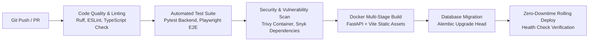

# 14-QA-DEVOPS-ROADMAP-AND-TRACEABILITY.md
# TapMenu HMS — Quality Assurance, DevOps, Implementation Roadmap, Traceability Matrix & Architecture Decision Records (ADRs)

---

## 1. Document Control & Metadata
- **Document Identifier:** `DOC-HMS-014`
- **System Name:** TapMenu HMS
- **Version:** 2.0.0
- **Document Status:** Implementation-Ready Engineering & QA Specification
- **Primary Source:** `TapMenu_HMS_Final_Client_Specification(1).docx` (Sections 18, 19, 20, 25, 26, 27, 28)
- **Traceability Tag:** `QA-TEST-*`, `DEVOPS-*`, `ROADMAP-*`, `ADR-*`

---

## 2. Quality Assurance & Comprehensive Testing Strategy

`[SOURCE REQUIREMENT]`
Quality Assurance is structured across unit, integration, concurrency, security, and end-to-end testing tiers using **Pytest** for backend services and **Playwright** for browser workflows.

### 2.1 The 14 Critical Hospitality Integration Tests

| Test Case ID | Critical Test Scenario | Target Subsystem | Validation Assertion & Invariant Verified |
| :--- | :--- | :--- | :--- |
| **TEST-CRIT-001** | **Last-Room Concurrent Booking Race** | Inventory Engine | Two concurrent booking requests target the final available room. Exactly 1 request succeeds with `201 Created`; 1 fails with `409 Conflict`. Zero double-bookings. Validates PostgreSQL row-level locks on `daily_inventory`. |
| **TEST-CRIT-002** | **Cancellation Inventory Release** | Reservations / Inv | Cancelling a confirmed booking immediately increments the `available_rooms` count and decrements `reserved_rooms` in `daily_inventory` for all dates in the stay range. |
| **TEST-CRIT-003** | **Out of Order (OOO) Allocation Lock** | Inventory / Front Desk | A room marked `OUT_OF_ORDER` cannot be assigned to an arrival or checked in. API returns `422 Unprocessable Entity`. |
| **TEST-CRIT-004** | **Room Service Active Stay Gate** | F&B / Room Service | Posting a room service charge via In-Room QR rejects if the room is vacant, checked-out, or token signature is expired. |
| **TEST-CRIT-005** | **Split Tender Folio Reconciliation** | Master Folio | Settle a ₹15,000 folio using ₹10,000 Card + ₹5,000 UPI. Folio balance reaches exactly ₹0.00; ledger credits match debits. |
| **TEST-CRIT-006** | **Manager Authorization for Refunds** | Payments / Security | Processing a cash or gateway refund fails with `403 Forbidden` unless authorized by a user with `payment:refund` role. |
| **TEST-CRIT-007** | **Manager Authorization for Discounts** | Folio / Security | Applying a manual folio discount requires manager credential verification and logs reason to `audit_logs`. |
| **TEST-CRIT-008** | **Checkout State Turnover** | Front Desk / HK | Finalizing guest checkout immediately updates physical room state from `OCCUPIED` to `VACANT_DIRTY` and queues a cleaning task. |
| **TEST-CRIT-009** | **Direct Website Reservation Ingestion** | Website API | Website booking API creates an identical standard reservation entity as front desk walk-ins, decrements inventory, and issues confirmation. |
| **TEST-CRIT-010** | **OTA Webhook Replay Protection** | Channel Manager | Replaying the same OTA reservation webhook payload multiple times returns `200 OK` but creates exactly 1 booking record via PostgreSQL unique constraint on `webhook_events`. |
| **TEST-CRIT-011** | **Payment Webhook Replay Protection** | Payment Gateway | Replaying a payment gateway webhook does not duplicate credit entries on the master folio. Deduplicated via PostgreSQL unique constraint. |
| **TEST-CRIT-012** | **Multi-Property Tenant Isolation** | Core / Auth | User authenticated to Property A cannot query, view, or modify rooms, folios, or guests belonging to Property B. |
| **TEST-CRIT-013** | **Unauthorized API Endpoint Access** | Security / RBAC | Invoking financial void or night audit endpoints without appropriate JWT permissions returns `401 Unauthorized` or `403 Forbidden`. |
| **TEST-CRIT-014** | **Guest KYC Document Access Control** | Object Storage | Public requests to guest document S3 URLs are denied; access permitted only via time-bound (15-min), authenticated presigned URLs. |

---

## 3. DevOps, Infrastructure & Deployment Architecture

### 3.1 Containerized Deployment Topology (Docker Compose)
`[SOURCE REQUIREMENT]` & `[ENGINEERING DECISION]`
The production deployment packages the modular monolith into portable Docker containers managed via Docker Compose or Kubernetes:

```
┌─────────────────────────────────────────────────────────────────────────────┐
│ PRODUCTION HOST / CLOUD INFRASTRUCTURE (AWS / Cloud VM)                    │
├─────────────────────────────────────────────────────────────────────────────┤
│ REVERSE PROXY CONTAINER (Nginx Alpine)                                      │
│ • Ports 80/443 (Let's Encrypt TLS 1.3)                                      │
│ • Reverse Proxy -> /api/v1/* to FastAPI, / to Vite Static Files             │
├─────────────────────────────────────────────────────────────────────────────┤
│ APPLICATION CONTAINER (FastAPI Modular Monolith)                            │
│ • Python 3.11-slim, Gunicorn worker manager + Uvicorn worker class          │
│ • Auto-runs Alembic migrations on startup                                   │
├─────────────────────────────────────────────────────────────────────────────┤
│ ASYNC WORKER CONTAINER (Celery Worker Pool)                                 │
│ • Concurrency: 4 workers per CPU core; handles PDF, WhatsApp, Channel sync │
├─────────────────────────────────────────────────────────────────────────────┤
│ SCHEDULER CONTAINER (Celery Beat)                                           │
│ • Manages scheduled crons: Night audit rollover, hold cleanup               │
├──────────────────────────────────────┬──────────────────────────────────────┤
│ PERSISTENCE TIER (Managed Services)  │ CACHE TIER (Managed Service)         │
│ • PostgreSQL 16+ (AWS RDS / Managed) │ • Redis 7.2+ (AWS ElastiCache)       │
│ • S3-Compatible Storage (AWS S3)     │                                      │
└──────────────────────────────────────┴──────────────────────────────────────┘
```

### 3.2 Continuous Integration & Continuous Deployment (CI/CD Pipeline)


### 3.3 Backup, Disaster Recovery & High Availability
- **Automated PostgreSQL Snapshots:** Full daily database backups retained for 30 days.
- **Continuous WAL Archiving:** Point-in-Time-Recovery (PITR) capable of restoring database state to any minute within the previous 7 days.
- **Health Check Endpoints:**
  - Liveness: `GET /api/v1/health/liveness` (HTTP 200 if app process responds).
  - Readiness: `GET /api/v1/health/readiness` (HTTP 200 only if PostgreSQL and Redis connections are verified).

---

## 4. Phased Implementation Roadmap

`[SOURCE REQUIREMENT]`
The implementation is structured into 9 strictly sequenced delivery phases:

```
Phase 1: Foundation (Auth, RBAC, Property, Room Types, Base DB)
   │
   ▼
Phase 2: Reservations & Availability (Daily Inventory Ledger, Rate Engine, Calendar, Allocation)
   │
   ▼
Phase 3: Front Desk & Guests (Check-in/out, KYC Document Storage, Room Moves, Guest 360)
   │
   ▼
Phase 4: Master Folio, Billing & Payments (GST Slabs, Invoices, Gateway)
   │
   ▼
Phase 5: Operations (Housekeeping Mobile, Offline Conflict Protocol, Maintenance, Linen, Minibar)
   │
   ▼
Phase 6: F&B POS & Kitchen Display (Table Plan, KDS, In-Room QR Dining)
   │
   ▼
Phase 7: Management BI & Reporting (Dashboards, ADR/RevPAR, Night Audit)
   │
   ▼
Phase 8: Connectivity (Direct Website APIs, Channel Manager Adapters, WhatsApp)
   │
   ▼
Phase 9: Hardening & Go-Live (Security Audit, Load Testing, Backups, Production)
```

---

## 5. Implementation Epics & Core User Stories

### Story ID: US-RES-001 (Atomic Booking Hold & Concurrency Safety)
- **Actor:** Guest / Booker / Front Desk Agent
- **Requirement:** System must atomically check and decrement sellable room inventory in `daily_inventory` during reservation confirmation.
- **Acceptance Criteria:**
  1. Concurrently booking the last available room confirms exactly 1 reservation and rejects conflicting attempts with `409 Conflict`.
  2. Inventory `available_rooms` count decrements and `reserved_rooms` increments atomically inside a PostgreSQL transaction (`SELECT ... FOR UPDATE`).
  3. Cancelling a reservation decrements `reserved_rooms` and restores `available_rooms`.
  4. Core booking operation succeeds even if Redis is unreachable.
- **Dependencies:** `FR-ROOM-001`, `FR-ROOM-002`, `daily_inventory`.
- **Security:** Idempotency key enforced; rate limited.
- **API Impact:** `POST /api/v1/reservations`.
- **Database Impact:** Inserts `reservations`, updates `daily_inventory`.

---

## 6. End-to-End Requirements Traceability Matrix

| Source Requirement | Business Rule ID | Database Entity | API Endpoint | UI Screen | Critical Test ID | Security Control |
| :--- | :--- | :--- | :--- | :--- | :--- | :--- |
| **Room Inventory & State** | `BR-ROOM-001` | `rooms`, `room_types` | `PATCH /rooms/{id}/status` | Room Matrix Grid | `TEST-CRIT-003` | `room:update_clean_status` |
| **Multi-Source Booking** | `BR-INV-001` | `reservations`, `daily_inventory` | `POST /reservations` | Reservation Modal | `TEST-CRIT-001` | PostgreSQL transactional locking (`SELECT FOR UPDATE`) + DB constraints + Idempotency (Redis optional) |
| **Guest Check-in & KYC** | `BR-FD-001` | `check_ins`, `guest_documents` | `POST /check-ins` | Front Desk Wizard | `TEST-CRIT-014` | Presigned S3 URLs (15-min TTL, zero public access) |
| **In-Room QR Dining** | `BR-POS-002` | `orders`, `kds_tickets` | `POST /guest/orders` | Mobile Web Menu | `TEST-CRIT-004` | Signed Ephemeral Token (HMAC-SHA256) |
| **Master Folio Posting** | `BR-FOLIO-001` | `folio_line_items` | `POST /folios/{id}/charges` | Master Folio Screen | `TEST-CRIT-005` | Financial Immutability (Append-only) |
| **Indian GST Calculation**| `BR-TAX-001` | `invoices`, `tax_rules` | `POST /folios/{id}/settle` | Tax Invoice Modal | `TEST-CRIT-005` | Integer Minor Units (Paise) |
| **Night Audit Rollover** | `BR-AUDIT-001` | `property_settings` | `POST /night-audit/execute`| Night Audit Wizard | `TEST-CRIT-008` | `night_audit:execute` permission |
| **Multi-Property Isolation**| `ARCH-MULTI-001`| `properties` | Global Middleware | Property Switcher | `TEST-CRIT-012` | Tenant Row-Level Scope (`property_id`) |
| **Payment Webhook Safety**| `BR-PAY-002` | `webhook_events` | `POST /payments/webhook` | N/A (Backend) | `TEST-CRIT-011` | PostgreSQL `UNIQUE(provider, event_id)` constraint |

---

## 7. Architecture Decision Records (ADR)

### ADR-001: Selection of API-First Modular Monolith Over Microservices
- **Status:** ACCEPTED.
- **Context:** Hotel operations require cross-departmental transactional integrity (e.g., checkout atomically settles folios, updates room status, creates tax invoices, and triggers housekeeping).
- **Decision:** Build as an API-First Modular Monolith in FastAPI and PostgreSQL with strict domain service interfaces. Microservices are rejected due to distributed transaction overhead.

### ADR-002: Integer Minor Currency Units for All Monetary Fields
- **Status:** ACCEPTED.
- **Context:** Floating-point rounding errors cause financial discrepancies during tax calculation and night audit reconciliation.
- **Decision:** Store all currency as 64-bit integers (`BIGINT`) representing minor currency units (paise in INR).

### ADR-003: PostgreSQL Authoritative Concurrency and Storage; Redis as Non-Authoritative Cache, Queue and Optional Coordination
- **Status:** ACCEPTED.
- **Context:** High-concurrency room inventory bookings, financial ledgers, and webhook events require strict consistency. Making reservation availability depend on Redis introduces an unnecessary availability failure mode where Redis downtime disables front desk operations.
- **Decision:** PostgreSQL is the sole transactional source of truth and authoritative lock manager (`SELECT ... FOR UPDATE` on `daily_inventory`). Reservation correctness, inventory decrementing, and webhook deduplication rely 100% on PostgreSQL transactions and constraints. Redis serves strictly as a non-authoritative read cache, Celery message broker, and optional coordination layer. If Redis is unavailable, the core booking and front-desk engine remains 100% operational.

---

## 8. Final Engineering & Documentation Consistency Audit

`[MANDATORY VERIFICATION]`
A rigorous consistency review confirms alignment across all 15 specification documents:

1. **Major Requirements Coverage:** 100% of functional requirements from `TapMenu_HMS_Final_Client_Specification(1).docx` are modeled.
2. **Internal Consistency:** Room state machine, reservation states (`PENDING`, `CONFIRMED`, `CANCELLED`, `NO_SHOW`, `COMPLETED`), stay states (`SCHEDULED`, `CHECKED_IN`, `CHECKED_OUT`), folio ledger rules, and security permissions are identical across all documents without contradiction.
3. **Purity of Scope:** Core MVP features are clearly demarcated from Phase 2 and Future strategic roadmap items.
4. **Client & Legal Decision Points:** All unconfirmed hotel-specific operational variables (exact tax rates, check-in times, room numbers, staff roles) are explicitly flagged with `TBD — Client decision required` and `[LEGAL/COMPLIANCE VALIDATION REQUIRED]`.
5. **No Premature Overengineering:** Architecture strictly adheres to the requested technology baseline (FastAPI, React 19, PostgreSQL, Redis, Celery, Docker) without unrequested microservices or distributed streaming infrastructure.
